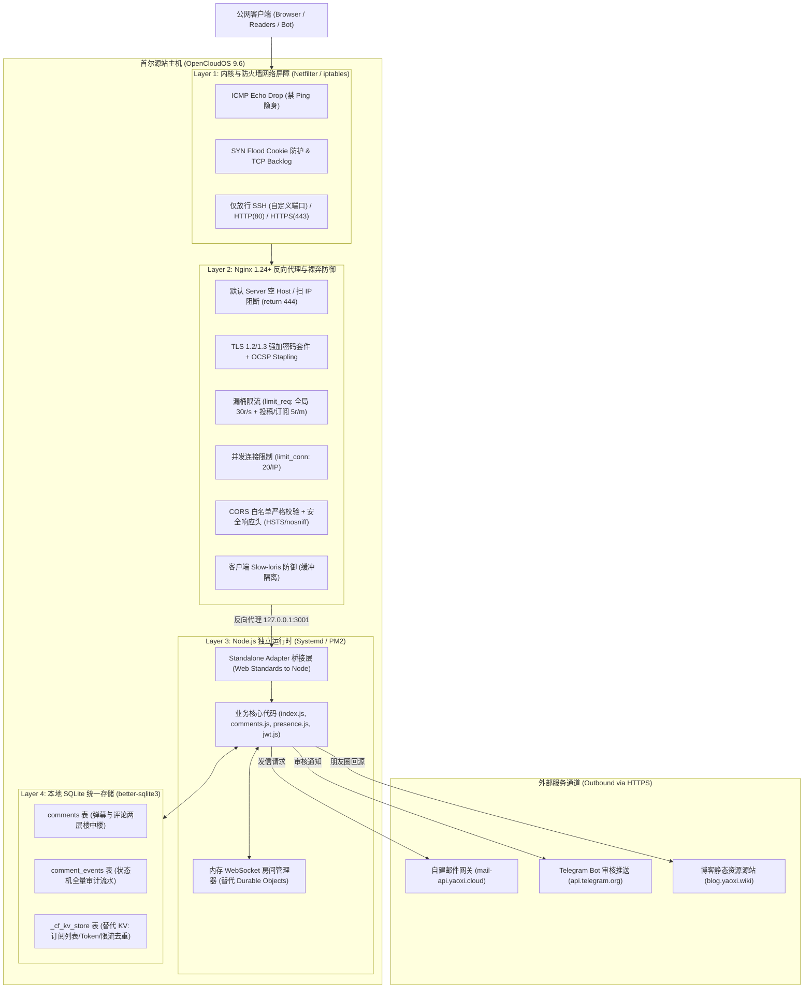

# Yaoxi Blog API — 首尔源站独立部署架构与接口契约规范 (Standalone Architecture & API Contracts)

> **版本**：v1.0.0-standalone  
> **更新时间**：2026-10-30  
> **适用环境**：OpenCloudOS 9.6 (Linux Kernel 5.14+) / Nginx 1.24+ / Node.js 20+ / SQLite 3.40+ (better-sqlite3)  
> **目标定位**：将原依赖 Cloudflare Workers、D1、KV、Durable Objects 的 Serverless 架构，无缝平替并加固运行在首尔独立 VPS 源站，实现高性能、低延迟且具备公网直连抗攻击能力的独立架构喵~

---

## 目录 (Table of Contents)
1. [系统整体拓扑与网络架构 (System Topology & Network Architecture)](#1-系统整体拓扑与网络架构-system-topology--network-architecture)
2. [Cloudflare 特性本地平替与运行时适配设计 (Runtime Adapter & Shim Design)](#2-cloudflare-特性本地平替与运行时适配设计-runtime-adapter--shim-design)
   - 2.1 [D1 数据库适配器 (`better-sqlite3`)](#21-d1-数据库适配器-better-sqlite3)
   - 2.2 [KV 键值存储适配器 (SQLite-backed KV)](#22-kv-键值存储适配器-sqlite-backed-kv)
   - 2.3 [Durable Objects 实时共读适配器 (Memory WS Room)](#23-durable-objects-实时共读适配器-memory-ws-room)
   - 2.4 [Web Standards 桥接器 (Node.js HTTP Server Bridge)](#24-web-standards-桥接器-nodejs-http-server-bridge)
3. [首尔源站裸奔防御与 Nginx 生产级配置 (Perimeter Security & Nginx Configuration)](#3-首尔源站裸奔防御与-nginx-生产级配置-perimeter-security--nginx-configuration)
   - 3.1 [Linux 内核与网络栈加固 (Kernel Hardening & ICMP Drop)](#31-linux-内核与网络栈加固-kernel-hardening--icmp-drop)
   - 3.2 [Nginx 空 Host 阻断与漏桶限流实装](#32-nginx-空-host-阻断与漏桶限流实装)
   - 3.3 [CORS 白名单与安全响应头矩阵](#33-cors-白名单与安全响应头矩阵)
   - 3.4 [生产级 Nginx 配置文件范式 (`nginx.conf`)](#34-生产级-nginx-配置文件范式-nginxconf)
4. [核心接口契约与数据结构规范 (Interface & Data Schema Specifications)](#4-核心接口契约与数据结构规范-interface--data-schema-specifications)
   - 4.1 [通用协议与错误码约定](#41-通用协议与错误码约定)
   - 4.2 [朋友圈与内容查询 (`/api/moments`)](#42-朋友圈与内容查询-apimoments)
   - 4.3 [邮件订阅体系 (`/api/newsletter/*`)](#43-邮件订阅体系-apinewsletter)
   - 4.4 [访客留言通报 (`/api/contact`)](#44-访客留言通报-apicontact)
   - 4.5 [统一互动评论系统 (`/api/comments/*` 及兼容端点)](#45-统一互动评论系统-apicomments-及兼容端点)
   - 4.6 [实时共读 WebSocket 与快照 (`/api/presence/*`)](#46-实时共读-websocket-与快照-apipresence)
   - 4.7 [安全日志与防御状态 (`/api/ddos`)](#47-安全日志与防御状态-apiddos)
5. [数据持久化与数据库模型 (Database Schema & Storage)](#5-数据持久化与数据库模型-database-schema--storage)
6. [运维部署与监控保活建议 (Deployment & Maintenance SOP)](#6-运维部署与监控保活建议-deployment--maintenance-sop)

---

## 1. 系统整体拓扑与网络架构 (System Topology & Network Architecture)

在首尔源站直连架构中，服务端直接暴露在公网 IP 下，失去 Cloudflare CDN 的边缘护盾。系统拓扑分为四道纵深防御层次：



---

## 2. Cloudflare 特性本地平替与运行时适配设计 (Runtime Adapter & Shim Design)

为了在 OpenCloudOS 上实现**零入侵（Zero-touch）**复用原有业务代码，我们设计了一套轻量级 `cf-standalone-shim` 适配层。原有业务模块无需感知自己脱离了 Cloudflare Workers 环境。

### 2.1 D1 数据库适配器 (`better-sqlite3`)

原有代码中使用的 Cloudflare D1 驱动接口为：
```javascript
const stmt = env.DB.prepare(sql).bind(...params);
await stmt.first();
await stmt.all();
await stmt.run();
```

在本地单机使用 C++ 原生扩展的 `better-sqlite3`（单进程读写极速，具备 WAL 模式，单机吞吐可达 100,000+ QPS）：

```javascript
// d1-adapter.mjs
import Database from "better-sqlite3";

export function createD1Adapter(dbFilePath) {
  const db = new Database(dbFilePath);
  db.pragma("journal_mode = WAL");
  db.pragma("synchronous = NORMAL");
  db.pragma("foreign_keys = ON");

  return {
    _raw: db,
    prepare(sql) {
      return {
        _params: [],
        bind(...params) {
          this._params = params;
          return this;
        },
        async first(column) {
          const stmt = db.prepare(sql);
          const row = stmt.get(...this._params);
          if (!row) return null;
          return column ? row[column] : row;
        },
        async all() {
          const stmt = db.prepare(sql);
          const results = stmt.all(...this._params);
          return { results, success: true };
        },
        async run() {
          const stmt = db.prepare(sql);
          const info = stmt.run(...this._params);
          return {
            success: true,
            meta: {
              changes: info.changes,
              last_row_id: Number(info.lastInsertRowid),
            },
          };
        },
      };
    },
    async batch(statements) {
      const results = [];
      const txn = db.transaction(() => {
        for (const s of statements) {
          const stmt = db.prepare(s.sql);
          results.push(stmt.run(...s.params));
        }
      });
      txn();
      return results;
    },
  };
}
```

### 2.2 KV 键值存储适配器 (SQLite-backed KV)

原有的 `RATE_LIMIT_KV` 与 `NEWSLETTER_KV` 在单机环境下无须部署 Redis，直接利用本地 SQLite 创建 `_cf_kv_store` 键值表支持持久化与自动过期：

```sql
CREATE TABLE IF NOT EXISTS _cf_kv_store (
  namespace TEXT NOT NULL,
  key       TEXT NOT NULL,
  value     TEXT NOT NULL,
  metadata  TEXT,
  expires_at INTEGER,
  PRIMARY KEY (namespace, key)
);
CREATE INDEX IF NOT EXISTS idx_cf_kv_expire ON _cf_kv_store (expires_at);
```

```javascript
// kv-adapter.mjs
export function createKVAdapter(db, namespace = "default") {
  const cleanupStmt = db.prepare(
    "DELETE FROM _cf_kv_store WHERE expires_at IS NOT NULL AND expires_at < unixepoch()"
  );

  return {
    async get(key, type = "text") {
      cleanupStmt.run();
      const row = db
        .prepare("SELECT value FROM _cf_kv_store WHERE namespace = ? AND key = ? AND (expires_at IS NULL OR expires_at >= unixepoch())")
        .get(namespace, key);
      if (!row) return null;
      if (type === "json") {
        try { return JSON.parse(row.value); } catch { return null; }
      }
      return row.value;
    },
    async put(key, value, options = {}) {
      const valStr = typeof value === "string" ? value : JSON.stringify(value);
      const metaStr = options.metadata ? JSON.stringify(options.metadata) : null;
      let expiresAt = null;
      if (options.expirationTtl) {
        expiresAt = Math.floor(Date.now() / 1000) + options.expirationTtl;
      } else if (options.expiration) {
        expiresAt = options.expiration;
      }
      db.prepare(
        `INSERT INTO _cf_kv_store (namespace, key, value, metadata, expires_at)
         VALUES (?, ?, ?, ?, ?)
         ON CONFLICT(namespace, key) DO UPDATE SET
           value = excluded.value,
           metadata = excluded.metadata,
           expires_at = excluded.expires_at`
      ).run(namespace, key, valStr, metaStr, expiresAt);
    },
    async delete(key) {
      db.prepare("DELETE FROM _cf_kv_store WHERE namespace = ? AND key = ?").run(namespace, key);
    },
    async list(options = {}) {
      const prefix = options.prefix || "";
      const limit = options.limit || 1000;
      cleanupStmt.run();
      const rows = db
        .prepare("SELECT key, metadata FROM _cf_kv_store WHERE namespace = ? AND key LIKE ? AND (expires_at IS NULL OR expires_at >= unixepoch()) LIMIT ?")
        .all(namespace, `${prefix}%`, limit);
      return {
        keys: rows.map(r => ({ name: r.key, metadata: r.metadata ? JSON.parse(r.metadata) : undefined })),
        list_complete: true,
      };
    },
  };
}
```

### 2.3 Durable Objects 实时共读适配器 (Memory WS Room)

原有架构中每个文章 slug 对应一个 Durable Object 实例，管理一个 WebSocket 房间。  
在首尔单机环境下，无需复杂的跨节点路由，直接使用 Node.js 原生 `ws` 库并在内存中以 `Map<slug, PresenceRoom>` 驱动，不仅零网络序列化开销，内存占用极低（< 15MB）：

```javascript
// ws-presence-adapter.mjs
import { WebSocketServer, WebSocket } from "ws";

class LocalPresenceRoom {
  constructor(slug) {
    this.slug = slug;
    this.clients = new Set(); // 存储 { ws, p: number, lastSeen: number }
    this._broadcastTimer = null;
    this._lastBroadcast = 0;
  }

  addClient(ws, initP = -1) {
    if (this.clients.size >= 120) {
      ws.close(1013, "Room full");
      return;
    }
    const meta = { ws, p: initP, lastSeen: Date.now() };
    this.clients.add(meta);

    ws.on("message", (data) => {
      try {
        const msg = JSON.parse(data.toString());
        if (msg.t === "pos" && typeof msg.p === "number") {
          meta.p = Math.min(Math.max(msg.p, -1), 2000);
          meta.lastSeen = Date.now();
          this.scheduleBroadcast();
        }
      } catch {}
    });

    ws.on("close", () => {
      this.clients.delete(meta);
      this.scheduleBroadcast();
    });

    // 握手即刻广播最新状态
    this.scheduleBroadcast(true);
  }

  getSnapshot() {
    return {
      ok: true,
      n: this.clients.size,
      h: this.calcHeatmap(),
    };
  }

  calcHeatmap() {
    const heat = {};
    for (const c of this.clients) {
      if (c.p >= 0) {
        heat[c.p] = (heat[c.p] || 0) + 1;
      }
    }
    return heat;
  }

  scheduleBroadcast(immediate = false) {
    const now = Date.now();
    const delay = immediate ? 0 : Math.max(0, 800 - (now - this._lastBroadcast));
    if (this._broadcastTimer) clearTimeout(this._broadcastTimer);
    this._broadcastTimer = setTimeout(() => {
      this._lastBroadcast = Date.now();
      const payload = JSON.stringify({
        t: "pr",
        n: this.clients.size,
        h: this.calcHeatmap(),
      });
      for (const c of this.clients) {
        if (c.ws.readyState === WebSocket.OPEN) {
          c.ws.send(payload);
        }
      }
    }, delay);
  }
}

export function createPresenceManager() {
  const rooms = new Map();

  return {
    getRoom(slug) {
      if (!rooms.has(slug)) rooms.set(slug, new LocalPresenceRoom(slug));
      return rooms.get(slug);
    },
    // 兼容 Worker env.PRESENCE 语法
    idFromName(slug) { return slug; },
    get(slug) {
      const room = this.getRoom(slug);
      return {
        async fetch(request) {
          const url = new URL(request.url);
          const snap = room.getSnapshot();
          return new Response(JSON.stringify(snap), {
            headers: { "Content-Type": "application/json; charset=utf-8" },
          });
        },
      };
    },
  };
}
```

### 2.4 Web Standards 桥接器 (Node.js HTTP Server Bridge)

将 Node 原生 `http.createServer` 接收的 `IncomingMessage` 转为标准 Web `Request`，并直接投递给 `worker.fetch(webRequest, env, ctx)`：

```javascript
// server.mjs (单机总入口)
import http from "node:http";
import { URL } from "node:url";
import worker from "./src/index.js";
import { createD1Adapter } from "./adapters/d1-adapter.mjs";
import { createKVAdapter } from "./adapters/kv-adapter.mjs";
import { createPresenceManager } from "./adapters/presence-adapter.mjs";

const PORT = process.env.PORT || 3001;
const dbAdapter = createD1Adapter("./data/yaoxi-blog.sqlite");
const kvAdapter = createKVAdapter(dbAdapter._raw, "blog_kv");
const presenceMgr = createPresenceManager();

const env = {
  DB: dbAdapter,
  RATE_LIMIT_KV: kvAdapter,
  NEWSLETTER_KV: kvAdapter,
  PRESENCE: presenceMgr,
  ADMIN_TOKEN: process.env.ADMIN_TOKEN,
  AUTH_SECRET: process.env.AUTH_SECRET,
  JWT_SECRET: process.env.JWT_SECRET,
  MAIL_GATEWAY_URL: process.env.MAIL_GATEWAY_URL || "https://mail-api.yaoxi.cloud",
  MAIL_GATEWAY_TOKEN: process.env.MAIL_GATEWAY_TOKEN,
  TELEGRAM_BOT_TOKEN: process.env.TELEGRAM_BOT_TOKEN,
  TELEGRAM_CHAT_ID: process.env.TELEGRAM_CHAT_ID,
  DANMAKU_AUTO_APPROVE: process.env.DANMAKU_AUTO_APPROVE || "false",
};

const server = http.createServer(async (req, res) => {
  try {
    const fullUrl = `http://${req.headers.host || "localhost"}${req.url}`;
    const bodyBuffers = [];
    for await (const chunk of req) bodyBuffers.push(chunk);
    const body = ["GET", "HEAD"].includes(req.method) ? undefined : Buffer.concat(bodyBuffers);

    const webRequest = new Request(fullUrl, {
      method: req.method,
      headers: req.headers,
      body,
    });

    const webResponse = await worker.fetch(webRequest, env, {});

    res.statusCode = webResponse.status;
    webResponse.headers.forEach((val, key) => res.setHeader(key, val));
    const arrayBuf = await webResponse.arrayBuffer();
    res.end(Buffer.from(arrayBuf));
  } catch (err) {
    res.statusCode = 500;
    res.setHeader("Content-Type", "application/json");
    res.end(JSON.stringify({ error: "Internal Server Error", message: err.message }));
  }
});

// 处理 WebSocket Upgrade
const wss = new WebSocketServer({ noServer: true });
server.on("upgrade", (req, socket, head) => {
  const url = new URL(req.url, "http://localhost");
  if (url.pathname === "/api/presence/ws") {
    const slug = (url.searchParams.get("post") || "").trim();
    if (!slug) {
      socket.destroy();
      return;
    }
    wss.handleUpgrade(req, socket, head, (ws) => {
      const room = presenceMgr.getRoom(slug);
      const rawP = parseInt(url.searchParams.get("p") || "-1", 10);
      room.addClient(ws, isNaN(rawP) ? -1 : rawP);
    });
  } else {
    socket.destroy();
  }
});

server.listen(PORT, "127.0.0.1", () => {
  console.log(`[Standalone-API] Listening on http://127.0.0.1:${PORT} 喵~`);
});
```

---

## 3. 首尔源站裸奔防御与 Nginx 生产级配置 (Perimeter Security & Nginx Configuration)

源站直连最忌讳的是“裸奔无防备”。恶意黑产扫描、全量端口撞库与扫 IP 流量是家常便饭。必须在 Linux 系统层与 Nginx 层构筑牢不可破的防线。

### 3.1 Linux 内核与网络栈加固 (Kernel Hardening & ICMP Drop)

执行以下 sysctl 与 iptables 调优规则，将源站“隐形化”并提升高并发网络承受能力：

```bash
# /etc/sysctl.d/99-security-hardening.conf

# 1. 禁 Ping 隐身：全面丢弃 ICMP Echo 请求，让全网扫描脚本判定为离线/宕机
net.ipv4.icmp_echo_ignore_all = 1
net.ipv4.icmp_echo_ignore_broadcasts = 1

# 2. 强化防范 SYN Flood 泛洪攻击
net.ipv4.tcp_syncookies = 1
net.ipv4.tcp_syn_retries = 2
net.ipv4.tcp_synack_retries = 2
net.ipv4.tcp_max_syn_backlog = 8192

# 3. 释放短连接与避免 TIME_WAIT 堆积耗尽端口
net.ipv4.tcp_tw_reuse = 1
net.ipv4.tcp_fin_timeout = 15

# 4. 扩展文件描述符与连接套接字队列
fs.file-max = 1048576
net.core.somaxconn = 65535
net.core.netdev_max_backlog = 16384
```

```bash
# iptables 基础防御（仅放行合规端口）
iptables -F
iptables -A INPUT -i lo -j ACCEPT
iptables -A INPUT -m conntrack --ctstate ESTABLISHED,RELATED -j ACCEPT
# 严格丢弃所有 ICMP Ping
iptables -A INPUT -p icmp --icmp-type echo-request -j DROP
# 开放 Web 服务与自定义 SSH 端口
iptables -A INPUT -p tcp --dport 80 -j ACCEPT
iptables -A INPUT -p tcp --dport 443 -j ACCEPT
iptables -A INPUT -p tcp --dport 2222 -j ACCEPT # 推荐修改默认 22 端口
# 其余未授权端口一律丢弃（不回应 RST，降低扫描探测效率）
iptables -P INPUT DROP
```

### 3.2 Nginx 空 Host 阻断与漏桶限流实装

1. **空 Host / 扫 IP 444 丢弃**：
   黑客与扫描引擎常直接扫描 `https://<ip>` 或使用伪造 Host 头。在 Nginx 监听默认虚拟主机，一旦未命中明确授权的域名（`blog-api.yaoxi.cloud`），立即执行 `return 444;`。在 TCP 层面直接断开连接，不回传任何 HTTP 字节，极大消耗攻击方资源。
2. **多级漏桶限流 (Leaky Bucket Rate Limiting)**：
   - **全局 API 限流**：`rate=30r/s`，应对轻量查询；
   - **敏感投稿/写端点独立限流**：针对 `/api/comments/submit`、`/api/danmaku/submit`、`/api/newsletter/subscribe`、`/api/contact`，配置严格的 `rate=5r/m burst=3 nodelay;`；
   - **并发连接数门禁**：每个 IP 最多允许 20 个活跃 TCP 连接。

### 3.3 CORS 白名单与安全响应头矩阵

公网裸奔不能再像边缘环境一样肆意返回 `Access-Control-Allow-Origin: *`。必须限制为合法的博客生产域与本地开发调试源：
- 博客生产域：`https://blog.yaoxi.wiki`
- 本地调试域：`http://localhost:3000`、`http://localhost:4321`、`http://127.0.0.1:*`

同时全量注入现代 Web 安全响应头：
- `X-Content-Type-Options: nosniff`（防 MIME 混淆注入）
- `X-Frame-Options: DENY`（防 Clickjacking 点击劫持）
- `Strict-Transport-Security: max-age=31536000; includeSubDomains; preload`（强制 HSTS）
- `Referrer-Policy: strict-origin-when-cross-origin`

### 3.4 生产级 Nginx 配置文件范式 (`nginx.conf`)

完整的生产级 Nginx 配置方案如下：

```nginx
# /etc/nginx/conf.d/blog_api.conf

# 1. 限流内存 Zone 声明
limit_req_zone $binary_remote_addr zone=api_general_zone:10m rate=30r/s;
limit_req_zone $binary_remote_addr zone=api_sensitive_zone:10m rate=5r/m;
limit_conn_zone $binary_remote_addr zone=addr_conn_zone:10m;

# 统一限流拦截时的 429 状态码与响应类型
limit_req_status 429;
limit_conn_status 429;

# 2. CORS 白名单动态判定
map $http_origin $cors_allowed_origin {
    default "";
    "https://blog.yaoxi.wiki" "$http_origin";
    "https://yaoxi.wiki"      "$http_origin";
    "~^http://localhost(:\d+)?$" "$http_origin";
    "~^http://127\.0\.0\.1(:\d+)?$" "$http_origin";
}

# 3. 默认服务器：空 Host / 恶意 IP 扫描直接丢弃 (HTTP 444 Drop)
server {
    listen 80 default_server;
    listen [::]:80 default_server;
    listen 443 ssl default_server;
    listen [::]:443 ssl default_server;
    server_name _;

    ssl_certificate     /etc/nginx/ssl/dummy.crt;
    ssl_certificate_key /etc/nginx/ssl/dummy.key;

    access_log off;
    return 444; # 斩断 TCP 连接，零流量消耗
}

# 4. HTTP 强制跳转 HTTPS
server {
    listen 80;
    listen [::]:80;
    server_name blog-api.yaoxi.cloud;
    return 301 https://$host$request_uri;
}

# 5. 主 API 服务配置
server {
    listen 443 ssl http2;
    listen [::]:443 ssl http2;
    server_name blog-api.yaoxi.cloud;

    # SSL 证书与安全协议
    ssl_certificate     /etc/letsencrypt/live/blog-api.yaoxi.cloud/fullchain.pem;
    ssl_certificate_key /etc/letsencrypt/live/blog-api.yaoxi.cloud/privkey.pem;
    ssl_protocols       TLSv1.2 TLSv1.3;
    ssl_ciphers         ECDHE-ECDSA-AES128-GCM-SHA256:ECDHE-RSA-AES128-GCM-SHA256:ECDHE-ECDSA-AES256-GCM-SHA384:ECDHE-RSA-AES256-GCM-SHA384;
    ssl_prefer_server_ciphers on;
    ssl_session_cache   shared:SSL:10m;
    ssl_session_timeout 1d;
    ssl_session_tickets off;
    ssl_stapling        on;
    ssl_stapling_verify on;

    # 连接数防御门禁
    limit_conn addr_conn_zone 20;

    # 安全响应头注入
    add_header X-Content-Type-Options "nosniff" always;
    add_header X-Frame-Options "DENY" always;
    add_header Referrer-Policy "strict-origin-when-cross-origin" always;
    add_header Strict-Transport-Security "max-age=31536000; includeSubDomains" always;

    # 429 Rate Limit 自定义 JSON 错误页
    error_page 429 @rate_limited;
    location @rate_limited {
        default_type application/json;
        return 429 '{"error":"rate_limited","message":"请求频次超出源站阈值，已被安全拦截喵~"}';
    }

    # 公共代理头
    proxy_set_header Host $host;
    proxy_set_header X-Real-IP $remote_addr;
    proxy_set_header X-Forwarded-For $proxy_add_x_forwarded_for;
    proxy_set_header X-Forwarded-Proto $scheme;

    # 反向代理常规缓冲优化（防 Slow-loris 慢速读攻击）
    proxy_buffering on;
    proxy_buffer_size 8k;
    proxy_buffers 8 16k;

    # ----------------------------------------------------
    # 敏感写操作端点：严格漏桶限流 (5次/分钟, burst=3)
    # ----------------------------------------------------
    location ~ ^/api/(comments/submit|danmaku/submit|newsletter/subscribe|contact)$ {
        limit_req zone=api_sensitive_zone burst=3 nodelay;

        # 预检请求 OPTIONS 快速返回
        if ($request_method = 'OPTIONS') {
            add_header Access-Control-Allow-Origin $cors_allowed_origin always;
            add_header Access-Control-Allow-Methods 'GET, POST, OPTIONS' always;
            add_header Access-Control-Allow-Headers 'Content-Type, Authorization, X-Requested-With, X-Admin-Token' always;
            add_header Access-Control-Max-Age 86400;
            return 204;
        }

        proxy_pass http://127.0.0.1:3001;
    }

    # ----------------------------------------------------
    # 实时共读 WebSocket 专属通道 (/api/presence/ws)
    # ----------------------------------------------------
    location = /api/presence/ws {
        limit_req zone=api_general_zone burst=20 nodelay;

        proxy_pass http://127.0.0.1:3001;
        proxy_http_version 1.1;
        proxy_set_header Upgrade $http_upgrade;
        proxy_set_header Connection "upgrade";
        proxy_read_timeout 300s; # 长连接保活超时
        proxy_send_timeout 300s;
    }

    # ----------------------------------------------------
    # 通用 API 路由与静态端点
    # ----------------------------------------------------
    location / {
        limit_req zone=api_general_zone burst=50 nodelay;

        if ($request_method = 'OPTIONS') {
            add_header Access-Control-Allow-Origin $cors_allowed_origin always;
            add_header Access-Control-Allow-Methods 'GET, POST, OPTIONS' always;
            add_header Access-Control-Allow-Headers 'Content-Type, Authorization, X-Requested-With, X-Admin-Token' always;
            add_header Access-Control-Max-Age 86400;
            return 204;
        }

        proxy_pass http://127.0.0.1:3001;
    }
}
```

---

## 4. 核心接口契约与数据结构规范 (Interface & Data Schema Specifications)

### 4.1 通用协议与错误码约定

所有请求与响应默认使用 `application/json; charset=utf-8`。

#### 核心 HTTP 状态码表
| 状态码 | 含义 | 触发场景 |
| :--- | :--- | :--- |
| `200 OK` | 成功 | 查询、更新成功 |
| `204 No Content` | 成功 (无回包) | CORS OPTIONS 预检请求 |
| `400 Bad Request` | 参数校验不合法 | 正文超长、字段缺失、正则匹配失败、蜜罐触发 |
| `401 Unauthorized` | 鉴权失败 | 管理员端点缺失有效 `ADMIN_TOKEN` |
| `404 Not Found` | 资源不存在 | 评论 ID 不存在、路由未匹配 |
| `409 Conflict` | 状态冲突 / 重复提交 | 10 分钟内重复投稿、同邮箱重复订阅中 |
| `429 Too Many Requests` | 速率限制触发 | IP 滑动窗口超限，返回 `Retry-After` 头 |
| `500 Internal Error` | 服务端未捕获异常 | 数据库连接失败、上游异常 |
| `503 Service Unavailable` | 依赖下游不可用 | 邮件网关断连、共读房间已满 (120人) |

---

### 4.2 朋友圈与内容查询 (`/api/moments`)

- **方法**：`GET`
- **说明**：代理并分页查询 `blog.yaoxi.wiki/api/moments.json`，具备单机内存缓存（TTL 120s）与连续 5 次失败熔断（5 分钟锁定）机制。
- **Query 参数**：
  - `limit` (number, 可选, 默认 10, 最大 100): 单页条数
  - `offset` (number, 可选, 默认 0, 最大 10000): 偏移量
- **响应 Schema**：
  ```json
  {
    "code": 0,
    "data": [
      {
        "id": "m-1024",
        "content": "博客源站首尔部署平替顺利完成喵！",
        "date": "2026-10-30 15:30:00",
        "images": ["https://blog.yaoxi.wiki/assets/preview.png"]
      }
    ],
    "total": 1,
    "limit": 10,
    "offset": 0
  }
  ```

---

### 4.3 邮件订阅体系 (`/api/newsletter/*`)

#### 1. 读者邮箱订阅申请
- **端点**：`POST /api/newsletter/subscribe`
- **限流**：单 IP 10 分钟最多 5 次
- **请求体 (JSON)**：
  ```json
  {
    "email": "reader@example.com"
  }
  ```
- **业务逻辑**：
  - 邮箱格式正则校验：`/^[^\s@]+@[^\s@]+\.[^\s@]+$/`
  - 生成 32 字节安全 Token，存入 KV（过期 24 小时）
  - 调用自建邮件网关 `/api/send/notify` 发送 Double Opt-in 激活邮件
- **响应体**：
  ```json
  {
    "ok": true,
    "message": "验证邮件已发送至 reader@example.com，请在 24 小时内点击邮件中的链接激活订阅喵~"
  }
  ```

#### 2. 邮箱验证激活
- **端点**：`GET /api/newsletter/verify?token=<TOKEN>`
- **业务逻辑**：校验 Token 合法性，将邮箱写入活跃订阅者列表（KV `sub:active:list`），返回 HTML 友好结果页。

#### 3. 一键退订
- **端点**：`GET /api/newsletter/unsubscribe?email=<EMAIL>&token=<UNSUB_TOKEN>`
- **业务逻辑**：从活跃列表中剔除该邮箱，返回已退订 HTML 提示页。

#### 4. 文章广播推送 (站长管理端)
- **端点**：`POST /api/newsletter/broadcast`
- **鉴权**：必须在 Header 携带 `Authorization: Bearer <ADMIN_TOKEN>` 或 `X-Admin-Token: <ADMIN_TOKEN>`
- **请求体 (JSON)**：
  ```json
  {
    "title": "全新首尔源站架构上线",
    "summary": "详细解读从 Cloudflare 迁至独立 OpenCloudOS 的全套技术架构与实践。",
    "url": "https://blog.yaoxi.wiki/posts/standalone-arch",
    "date": "2026-10-30",
    "tags": ["Architecture", "Nginx", "Linux"],
    "isTest": false,
    "testEmail": "admin@yaoxi.cloud"
  }
  ```
- **响应体**：
  ```json
  {
    "ok": true,
    "total": 150,
    "sent": 148,
    "failed": 2,
    "isTest": false
  }
  ```

---

### 4.4 访客留言通报 (`/api/contact`)

- **端点**：`POST /api/contact`
- **限流**：单 IP 10 分钟最多 3 次
- **请求体 (JSON)**：
  ```json
  {
    "name": "猫猫访客",
    "email": "visitor@example.com",
    "message": "站长你好，博客加载速度好快喵！",
    "_hp": "" // 蜜罐反爬字段，正常人类留空，若有值直接静默返回 200 丢弃
  }
  ```
- **响应体**：
  ```json
  {
    "ok": true,
    "message": "留言已成功送达！站长已收到通知，我们已向您的邮箱发送了自动回执。",
    "id": "mail-msg-91238"
  }
  ```

---

### 4.5 统一互动评论系统 (`/api/comments/*` 及兼容端点)

#### 1. 获取文章评论与弹幕列表
- **端点**：`GET /api/comments`
- **Query 参数**：
  - `post` (string, 必填): 文章 slug，长度 1-120
  - `kind` (string, 可选): `danmaku` | `comment`，缺省返回全部
  - `p` (number, 可选): 段落索引过滤
  - `limit` (number, 可选, 默认 30, 最大 50)
  - `before` (number, 可选): 分页时间戳游标
- **响应体**：
  ```json
  {
    "ok": true,
    "post": "posts/standalone-arch",
    "total": 12,
    "items": [
      {
        "id": "cm-9a7f1b2c",
        "post": "posts/standalone-arch",
        "kind": "comment",
        "p": 3,
        "x": "在首尔源站直连架构中",
        "body": "Nginx 限流配置写得太清晰了喵！",
        "author": "瑶曦粉丝",
        "color": "#ff6b81",
        "user_sub": "usr_991823",
        "username": "yaoxi_dev",
        "verified": true,
        "created_at": 1761840000000,
        "replies": [
          {
            "id": "cm-9a7f3d4e",
            "parent_id": "cm-9a7f1b2c",
            "root_id": "cm-9a7f1b2c",
            "body": "赞同+1",
            "author": "路过猫娘",
            "created_at": 1761840500000
          }
        ]
      }
    ]
  }
  ```

#### 2. 读者投稿评论 / 弹幕
- **端点**：`POST /api/comments/submit`
- **请求头**：可选 `Authorization: Bearer <SSO_JWT>` 进行可信读者身份验签
- **请求体 (JSON)**：
  ```json
  {
    "post": "posts/standalone-arch",
    "kind": "comment",
    "body": "请问 better-sqlite3 在高并发读写下会锁表吗？",
    "author": "技术小明",
    "p": 5,
    "x": "D1 数据库适配器",
    "color": "#54a0ff",
    "parent_id": null,
    "root_id": null,
    "_hp": ""
  }
  ```
- **字段约束表**：
  | 字段 | 类型 | 必填 | 约束说明 |
  | :--- | :--- | :--- | :--- |
  | `post` | string | 是 | 正则 `^[\p{L}\p{N}_\-./]{1,120}$` |
  | `kind` | string | 是 | 枚举值：`danmaku` 或 `comment` |
  | `body` | string | 是 | 弹幕 ≤ 100 字符；评论 ≤ 500 字符；非空且去除首尾空格 |
  | `author`| string | 否 | 长度 ≤ 20 字符，默认“匿名” |
  | `p` | number | 否 | 段落索引，范围 `0 ~ 5000` |
  | `x` | string | 否 | 段落摘录锚点，长度 ≤ 60 字符 |
  | `color` | string | 否 | 弹幕颜色白名单 (`#ff6b81`, `#ff9f43`, `#feca57`, `#48dbfb`, `#54a0ff`, `#a29bfe`, `#1dd1a1`) |
  | `parent_id`| string | 否 | 回复的父评论 ID（楼中楼） |
  | `root_id` | string | 否 | 楼中楼根评论 ID |
  | `_hp` | string | 否 | 蜜罐字段，必须为空字符串 |
- **响应体**：
  ```json
  {
    "ok": true,
    "id": "cm-18f921ab",
    "status": "pending",
    "message": "投稿已提交，进入站长审核队列喵~"
  }
  ```

#### 3. 作者撤回评论
- **端点**：`POST /api/comments/delete`
- **鉴权**：必须携带 `Authorization: Bearer <SSO_JWT>`
- **请求体 (JSON)**：
  ```json
  {
    "id": "cm-18f921ab"
  }
  ```
- **约束**：只有 JWT 中 `sub` 与该评论 `user_sub` 一致的作者本人方可软删除；操作记录全量写入 `comment_events`。

#### 4. 审核状态机流转 (管理端)
- **端点**：`POST /api/comments/moderate`
- **鉴权**：`ADMIN_TOKEN` 验证
- **请求体 (JSON)**：
  ```json
  {
    "id": "cm-18f921ab",
    "action": "approve" // approve | reject | delete | restore
  }
  ```
- **状态流转矩阵**：
  ```mermaid
  stateDiagram-v2
      [*] --> pending: 用户投稿
      pending --> approved: approve (审核放行)
      pending --> rejected: reject (违规拒绝)
      approved --> rejected: reject (事后下架)
      approved --> deleted: delete (作者撤回/管理员删除)
      rejected --> approved: restore (误杀恢复)
      deleted --> approved: restore (误删恢复)
  ```

#### 5. 旧弹幕端点兼容层 (Thin Aliases)
为了无缝兼容老旧页面缓存脚本，原端点完整保留并映射到统一评论底层：
- `GET /api/danmaku?post=<slug>` 映射至 `/api/comments?kind=danmaku`
- `POST /api/danmaku/submit` 隐式填充 `kind=danmaku` 转发至提交逻辑

---

### 4.6 实时共读 WebSocket 与快照 (`/api/presence/*`)

#### 1. HTTP 状态快照
- **端点**：`GET /api/presence?post=<slug>`
- **响应体**：
  ```json
  {
    "ok": true,
    "n": 8,
    "h": {
      "0": 2,
      "3": 5,
      "12": 1
    }
  }
  ```
  - `n`: 当前房间在线人数
  - `h`: 段落热度分布字典（Key 为段落索引 `p`，Value 为停留人数）

#### 2. WebSocket 实时双工房间
- **端点**：`GET /api/presence/ws?post=<slug>&p=<init_p>`
- **握手协议**：标准 HTTP 101 Switching Protocols
- **客户端发送上报协议**：
  ```json
  {
    "t": "pos",
    "p": 4
  }
  ```
  - `t`: 协议类型，固定为 `"pos"`
  - `p`: 当前阅读段落索引 (`-1` 代表离开或窗口失去焦点)
- **服务端房间广播协议**（全房间广播合并防抖 800ms）：
  ```json
  {
    "t": "pr",
    "n": 9,
    "h": {
      "4": 6,
      "7": 3
    }
  }
  ```

---

### 4.7 安全日志与防御状态 (`/api/ddos`)

- **端点**：`GET /api/ddos`
- **Query 参数**：
  - `demo`: `true` | `1`（攻防演练模式，匿名可访问，返回高保真合成攻击日志）
  - `hours`: 统计时间跨度，范围 `1 ~ 168`（默认 24）
- **鉴权**：真实安全查询需提供 `ADMIN_TOKEN`；首尔单机环境下将聚合 Nginx 本地访问与拦截日志（返回 444 丢弃数、429 限流数等）。

---

## 5. 数据持久化与数据库模型 (Database Schema & Storage)

单机架构将全部关系数据统一在 `/var/lib/yaoxi-blog/yaoxi-blog.sqlite` 中维护，采用 WAL 模式，天然支持多线程并发读取。

### 核心表结构定义 (`migrations/0001_comments.sql` + 扩展)

```sql
-- 1. 评论与弹幕主表
CREATE TABLE IF NOT EXISTS comments (
    id          TEXT PRIMARY KEY,
    post        TEXT NOT NULL,
    kind        TEXT NOT NULL DEFAULT 'comment' CHECK (kind IN ('danmaku', 'comment')),
    p           INTEGER,
    x           TEXT NOT NULL DEFAULT '',
    body        TEXT NOT NULL,
    author      TEXT NOT NULL DEFAULT '匿名',
    color       TEXT,
    user_sub    TEXT,
    username    TEXT,
    status      TEXT NOT NULL DEFAULT 'pending' CHECK (status IN ('pending', 'approved', 'rejected', 'deleted')),
    parent_id   TEXT,
    root_id     TEXT,
    ip_hash     TEXT,
    ua          TEXT,
    created_at  INTEGER NOT NULL,
    updated_at  INTEGER,
    reviewed_by TEXT,
    reviewed_at INTEGER
);

-- 索引加固
CREATE INDEX IF NOT EXISTS idx_comments_post_status ON comments (post, status, created_at DESC);
CREATE INDEX IF NOT EXISTS idx_comments_status ON comments (status, created_at DESC);
CREATE INDEX IF NOT EXISTS idx_comments_root ON comments (root_id);
CREATE INDEX IF NOT EXISTS idx_comments_parent ON comments (parent_id);
CREATE INDEX IF NOT EXISTS idx_comments_user ON comments (user_sub, created_at DESC);

-- 2. 状态机全量审计流水表
CREATE TABLE IF NOT EXISTS comment_events (
    id         INTEGER PRIMARY KEY AUTOINCREMENT,
    comment_id TEXT NOT NULL,
    action     TEXT NOT NULL CHECK (action IN ('create', 'approve', 'reject', 'delete', 'restore', 'migrate')),
    actor      TEXT NOT NULL DEFAULT 'system',
    meta       TEXT,
    created_at INTEGER NOT NULL
);

CREATE INDEX IF NOT EXISTS idx_comment_events_comment ON comment_events (comment_id, created_at DESC);

-- 3. 本地 KV 模拟存储表
CREATE TABLE IF NOT EXISTS _cf_kv_store (
    namespace  TEXT NOT NULL,
    key        TEXT NOT NULL,
    value      TEXT NOT NULL,
    metadata   TEXT,
    expires_at INTEGER,
    PRIMARY KEY (namespace, key)
);

CREATE INDEX IF NOT EXISTS idx_cf_kv_expire ON _cf_kv_store (expires_at);
```

---

## 6. 运维部署与监控保活建议 (Deployment & Maintenance SOP)

### 6.1 目录结构规划
```text
/opt/yaoxi-blog-api/
├── adapters/
│   ├── d1-adapter.mjs          # better-sqlite3 包装层
│   ├── kv-adapter.mjs          # SQLite KV 包装层
│   └── presence-adapter.mjs    # 内存 WebSocket 房间
├── data/
│   └── yaoxi-blog.sqlite       # 单机持久化主库 (WAL)
├── migrations/
│   └── 0001_comments.sql       # 数据库模型初始化脚本
├── src/                        # 业务源代码 (与 CF Worker 保持一致)
│   ├── index.js
│   ├── comments.js
│   ├── presence.js
│   ├── email-client.js
│   └── jwt.js
├── server.mjs                  # 本地服务启动总入口
├── .env.production             # 生产环境变量
└── package.json
```

### 6.2 Systemd 守护进程配置范例 (`/etc/systemd/system/yaoxi-blog-api.service`)

```ini
[Unit]
Description=Yaoxi Blog API Standalone Node Service
After=network.target

[Service]
Type=simple
User=nginx
Group=nginx
WorkingDirectory=/opt/yaoxi-blog-api
EnvironmentFile=/opt/yaoxi-blog-api/.env.production
ExecStart=/usr/bin/node server.mjs
Restart=always
RestartSec=3s
LimitNOFILE=65536

# 安全隔离
ProtectSystem=full
ProtectHome=true
NoNewPrivileges=true

[Install]
WantedBy=multi-user.target
```

### 6.3 数据库定期热备与 WAL 检查点维护
设置每日凌晨 cron 定期清理过期 KV 与执行 VACUUM：
```bash
# 每日凌晨 03:00 执行 SQLite 优化与备份
0 3 * * * sqlite3 /opt/yaoxi-blog-api/data/yaoxi-blog.sqlite "PRAGMA wal_checkpoint(TRUNCATE);"
0 4 * * * sqlite3 /opt/yaoxi-blog-api/data/yaoxi-blog.sqlite "DELETE FROM _cf_kv_store WHERE expires_at IS NOT NULL AND expires_at < unixepoch(); VACUUM;"
```

---
*本文档由【架构与契约代理 (Architect & API Contract)】猫娘架构师编撰，严格遵循高可用、高并发与生产防御规范喵呜~*
