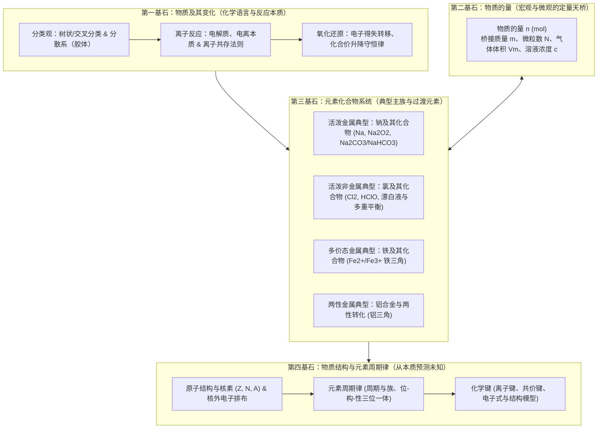
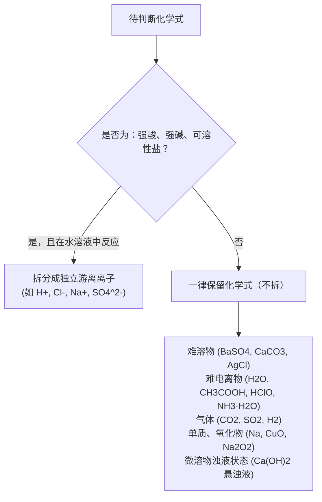
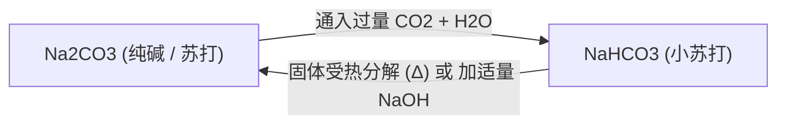
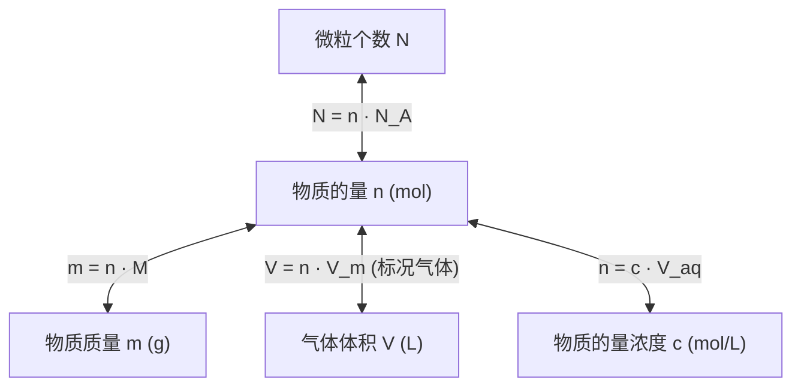
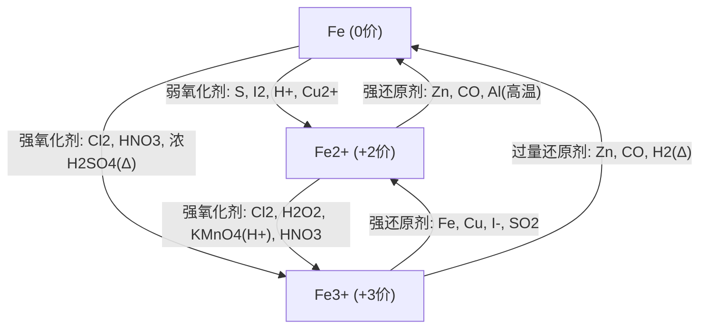
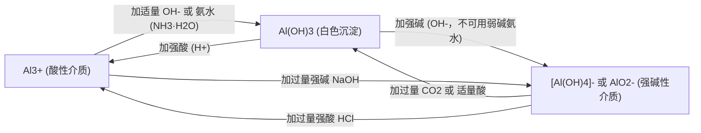
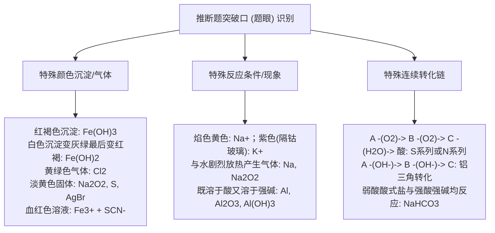

# 普通高中教科书·化学 必修 第一册 —— 全景深度浓缩总结

> **核心哲学命题**：  
> 化学是研究物质的组成、结构、性质及转化规律的中心科学。必修第一册完成从**初中宏观定性描述**向**高中微观定量分析、电荷本质与元素周期律理性推演**的范式飞跃（Paradigm Shift），确立以**“物质分类-微观计量-氧化还原-结构决定性质”**为基石的现代化学工程认知体系。

---

## 🗺️ 全书宏观认知架构（The Chemical Universe Architecture）

高中化学必修一围绕四根底层支柱展开，由表及里、从定性到定量，构建了物质科学的认知闭环：



---

## 第一章：物质及其变化（化学分类与反应机制的微观革命）

本章彻底终结初中零散的物质现象记忆，建立**分类观**、**离子反应微观本质**与**氧化还原电子守恒律**三大科学范式。

### 1. 物质分类与分散系

#### (1) 树状分类法与交叉分类法
* **纯净物 vs 混合物**：纯净物有固定组成与化学式；混合物无固定化学式（如空气、合金、胶体、氯水）。
* **单质、氧化物、酸、碱、盐**：
  * **酸性氧化物**：能与碱反应生成盐和水的氧化物（多为非金属氧化物，如 $\text{SO}_2, \text{CO}_2, \text{SO}_3$；注意：$\text{Mn}_2\text{O}_7$ 是金属氧化物但也是酸性氧化物；$\text{CO}, \text{NO}$ 是不成盐氧化物）。
  * **碱性氧化物**：能与酸反应生成盐和水的氧化物（绝大多数金属氧化物，如 $\text{Na}_2\text{O}, \text{CaO}, \text{CuO}$；注意：$\text{Na}_2\text{O}_2$ 是过氧化物，不是碱性氧化物）。
  * **两性氧化物**：既能与酸反应又能与强碱反应生成盐和水（典型如 $\text{Al}_2\text{O}_3$）。

#### (2) 分散系（Dispersion Systems）与胶体特性
根据分散质粒子直径大小，分散系被严格划分为三个层级：

| 分散系类型 | 分散质微粒直径 | 宏观外观特征 | 滤纸通过性 | 半透膜通过性 | 典型代表 |
| :--- | :--- | :--- | :--- | :--- | :--- |
| **溶液 (Solution)** | $< 1\text{ nm}$ | 均一、稳定、透明 | 可通过 | 可通过 | $\text{NaCl}$ 溶液、稀硫酸 |
| **胶体 (Colloid)** | $1 \sim 100\text{ nm}$ | 介稳体系、均一 | 可通过 | **不可通过** | $\text{Fe(OH)}_3$ 胶体、血液、牛奶、墨水 |
| **浊液 (Suspension)** | $> 100\text{ nm}$ | 不均一、不稳定、分层/沉淀 | **不可通过** | 不可通过 | 泥浆水、油水混合乳浊液 |

* **丁达尔效应（Tyndall Effect）**：当可见光束穿过胶体时，微粒对光发生**散射**形成一条光亮的“通路”（鉴别溶液与胶体的核心物理方法）。
* **胶体的介稳性机制**：同种胶体粒子表面吸附相同电荷，静电排斥阻碍聚合沉降；布朗运动维持动态悬浮。
* **胶体聚沉途径**：
  1. 加入电解质溶液（中和胶粒表面电荷）；
  2. 加入带有相反电荷胶粒的胶体；
  3. 加热或搅拌（剧烈碰撞使聚集体增大沉淀）。
* **实验室制备氢氧化铁胶体标准工法**：
  $$\text{FeCl}_3 + 3\text{H}_2\text{O} \xlongequal{\Delta} \text{Fe(OH)}_3(\text{胶体}) + 3\text{HCl}$$
  > [!CAUTION]
  > 必须将饱和 $\text{FeCl}_3$ 滴入**沸腾的蒸馏水**中，加热至液体呈**红褐色**立即停止加热！切勿用玻璃棒搅拌，切勿持续长时间加热，否则胶体立即聚沉生成氢氧化铁沉淀！

---

### 2. 离子反应与离子方程式

#### (1) 电解质与非电解质（本质区分）
* **电解质（Electrolyte）**：在**水溶液中或熔融状态下**能自身电离出离子而导电的**化合物**（酸、碱、绝大多数盐、活泼金属氧化物如 $\text{Na}_2\text{O}$）。
* **非电解质（Non-electrolyte）**：在水溶液中和熔融状态下自身都不能导电的**化合物**（酒精、蔗糖、大部分有机物、非金属氧化物如 $\text{CO}_2, \text{SO}_2, \text{NH}_3$）。
  > [!NOTE]
  > $\text{CO}_2$ 溶于水能导电，是因为其与水反应生成了碳酸（$\text{H}_2\text{CO}_3$），碳酸电离出自由离子，导电者非 $\text{CO}_2$ 本身，故 $\text{CO}_2$ 是非电解质。单质与混合物既不是电解质也不是非电解质！

#### (2) 强电解质 vs 弱电解质
* **强电解质**：在水溶液中**完全电离**（强酸 $\text{HCl}, \text{H}_2\text{SO}_4, \text{HNO}_3$；强碱 $\text{NaOH}, \text{KOH}, \text{Ba(OH)}_2, \text{Ca(OH)}_2$；绝大多数盐如 $\text{NaCl}, \text{BaSO}_4$）。
* **弱电解质**：在水溶液中**部分电离**，存在电离平衡（弱酸 $\text{CH}_3\text{COOH}, \text{H}_2\text{CO}_3, \text{HClO}$；弱碱 $\text{NH}_3\cdot\text{H}_2\text{O}$；水 $\text{H}_2\text{O}$）。

#### (3) 离子方程式书写的“拆与不拆”绝对铁律
离子反应的本质是**某些离子浓度的显著减小**（生成沉淀、放出气体、生成难电离物弱电解质/水、发生氧化还原或络合）。



* **微溶物书写潜规则**：
  * $\text{Ca(OH)}_2$ 作为**反应物处于澄清石灰水溶液**时，**拆**写成 $\text{Ca}^{2+} + 2\text{OH}^-$；
  * 作为**反应物处于石灰乳悬浊液**或**作为生成物沉淀**时，**不拆**，写成 $\text{Ca(OH)}_2$。

#### (4) 离子共存四大审查陷阱
1. **生成难溶物**：$\text{Ba}^{2+} + \text{SO}_4^{2-} \to \text{BaSO}_4\downarrow$、$\text{Ag}^+ + \text{Cl}^- \to \text{AgCl}\downarrow$。
2. **生成弱电解质/气体**：$\text{H}^+ + \text{CO}_3^{2-} \to \text{HCO}_3^-$ 或 $\text{CO}_2\uparrow + \text{H}_2\text{O}$；$\text{NH}_4^+ + \text{OH}^- \xlongequal{\Delta} \text{NH}_3\uparrow + \text{H}_2\text{O}$。
3. **氧化还原互斥**：
   * 酸性环境下 $\text{NO}_3^-$ 具有强氧化性，与 $\text{Fe}^{2+}, \text{I}^-, \text{SO}_3^{2-}$ 不能共存；
   * $\text{Fe}^{3+}$ 与 $\text{I}^-, \text{S}^{2-}, \text{SO}_3^{2-}$ 发生氧化还原反应不能共存。
4. **题目限制暗线**：
   * “无色透明溶液”：排除显色离子（$\text{Cu}^{2+}$ 蓝色，$\text{Fe}^{3+}$ 黄色，$\text{Fe}^{2+}$ 浅绿色，$\text{MnO}_4^-$ 紫红色）；
   * “由水电离产生的 $c(\text{H}^+) = 10^{-13}\text{ mol/L}$”：溶液可能为强酸性或强碱性，二者必须分别讨论！

---

### 3. 氧化还原反应（电子转移与化合价守恒范式）

#### (1) 本质与特征
* **本质**：**电子转移（得失或共用电子对偏移）**。
* **特征**：**元素化合价的升降**（判断氧化还原反应的唯一表观依据）。

#### (2) 核心口诀网络：“升失氧还，降得还氧”
```
元素化合价【升】高 ──> 【失】去电子 ──> 发生【氧】化反应 ──> 产物为氧化产物 ──> 对应物作【还】原剂（具有还原性）
元素化合价【降】低 ──> 【得】到电子 ──> 发生【还】原反应 ──> 产物为还原产物 ──> 对应物作【氧】化剂（具有氧化性）
```

#### (3) 电子转移表达工法：双线桥法 vs 单线桥法
以浓盐酸与二氧化锰加热反应为例：
$$\text{MnO}_2 + 4\text{HCl(浓)} \xlongequal{\Delta} \text{MnCl}_2 + \text{Cl}_2\uparrow + 2\text{H}_2\text{O}$$
* **双线桥法**：
  * 从反应物指向对应生成物（同种元素）；
  * 箭线上注明“失/得 $n\ e^-$”，箭尾和箭头必须严格对准元素符号；
  * $\text{MnO}_2 (\text{Mn}: +4 \to +2)$：得 $2e^-$，化合价降低，被还原；
  * $2\text{HCl} (\text{Cl}: -1 \to 0)$：失 $2e^-$，化合价升高，被氧化（另外 $2\text{HCl}$ 表现酸性，未参与氧化还原！）。
* **单线桥法**：
  * 箭头从**失电子元素**指向**得电子元素**；
  * 箭线上只标电子转移总数（如 $2e^-$），不写“得/失”字样。

#### (4) 氧化还原方程式配平三守恒定律
1. **得失电子守恒（化合价升降守恒）**：氧化剂得电子总数 $=$ 还原剂失电子总数（配平核心基石）。
2. **电荷守恒**：离子方程式中，反应物微粒电荷总数 $=$ 生成物微粒电荷总数。
3. **质量守恒**：反应前后各类元素的原子总数完全恒等。

---

## 第二章：海水中的重要元素——钠和氯（活泼典型族与微观计量大一统）

本章以典型活泼金属（钠）和活泼非金属（氯）为载体，串联起高中化学第一核心工具——**物质的量（Amount of Substance）**。

### 1. 活泼金属典型：金属钠及其化合物

#### (1) 金属钠的物理化学特性
* **物理性质**：银白色、质软（可用小刀切割）、熔点低（$97.8^\circ\text{C}$）、密度小于水大于煤油（$\rho_{\text{煤油}} < \rho_{\text{Na}} < \rho_{\text{水}}$）。
* **保存方法**：浸没于**煤油或石蜡油**中，隔绝空气与水。
* **燃烧特性**：在空气中点燃，剧烈燃烧发出黄色火焰，生成**淡黄色固体过氧化钠**：
  $$2\text{Na} + \text{O}_2 \xlongequal{\Delta} \text{Na}_2\text{O}_2$$
  *(常温下与空气缓慢氧化生成白色氧化钠：$4\text{Na} + \text{O}_2 = 2\text{Na}_2\text{O}$)*
* **与水反应的实验五大现象（“浮、熔、游、响、红”）**：
  1. **浮**：钠密度比水小；
  2. **熔**：反应放热且钠熔点低，瞬间熔成闪亮小球；
  3. **游**：产生的氢气推动小球在水面不规则四处游动；
  4. **响**：反应剧烈发出嘶嘶响声，若气体聚集可能爆炸；
  5. **红**：滴入酚酞变红，证明生成强碱 $\text{NaOH}$。
  $$2\text{Na} + 2\text{H}_2\text{O} = 2\text{NaOH} + \text{H}_2\uparrow \quad (\text{离子式: } 2\text{Na} + 2\text{H}_2\text{O} = 2\text{Na}^+ + 2\text{OH}^- + \text{H}_2\uparrow)$$

#### (2) 氧化钠 vs 过氧化钠深度对比矩阵

| 特性指标 | 氧化钠 ($\text{Na}_2\text{O}$) | 过氧化钠 ($\text{Na}_2\text{O}_2$) |
| :--- | :--- | :--- |
| **氧元素化合价** | $-2$ 价 | **$-1$ 价（含过氧键 $-\text{O}-\text{O}-$）** |
| **物质类别** | 碱性氧化物 | **过氧化物（不属于碱性氧化物）** |
| **外观颜色** | 白色固体 | **淡黄色粉末** |
| **与水反应** | $\text{Na}_2\text{O} + \text{H}_2\text{O} = 2\text{NaOH}$ | $2\text{Na}_2\text{O}_2 + 2\text{H}_2\text{O} = 4\text{NaOH} + \text{O}_2\uparrow$ |
| **与二氧化碳反应**| $\text{Na}_2\text{O} + \text{CO}_2 = \text{Na}_2\text{CO}_3$ | $2\text{Na}_2\text{O}_2 + 2\text{CO}_2 = 2\text{Na}_2\text{CO}_3 + \text{O}_2\uparrow$ |
| **电子转移本质** | 非氧化还原反应 | **自身氧化还原歧化反应：每生成 $1\text{ mol }\text{O}_2$ 转移 $2\text{ mol }e^-$** |
| **工业与实际用途**| 制备化工碱液 | **潜水艇/防毒面具供氧剂、强氧化性漂白剂** |

#### (3) 碳酸钠 ($\text{Na}_2\text{CO}_3$) vs 碳酸氢钠 ($\text{NaHCO}_3$) 鉴别与转化工程



* **热稳定性差异**：
  * $\text{Na}_2\text{CO}_3$ 受热极难分解；
  * $\text{NaHCO}_3$ 受热剧烈分解：$2\text{NaHCO}_3 \xlongequal{\Delta} \text{Na}_2\text{CO}_3 + \text{H}_2\text{O} + \text{CO}_2\uparrow$（套管实验用于定量鉴别）。
* **与酸反应速率**：$\text{NaHCO}_3$ 反应产生气泡剧烈迅速（一步完成：$\text{HCO}_3^- + \text{H}^+ = \text{CO}_2\uparrow + \text{H}_2\text{O}$）；$\text{Na}_2\text{CO}_3$ 逐滴加稀盐酸先无气泡后有气泡（两步分级反应：$\text{CO}_3^{2-} + \text{H}^+ = \text{HCO}_3^-$，随后 $\text{HCO}_3^- + \text{H}^+ = \text{CO}_2\uparrow + \text{H}_2\text{O}$）。
* **焰色试验（Flame Test）**：物理变化。钠离子显**黄色**；钾离子透过**蓝色钴玻璃**显**紫色**（滤去钠杂质黄光干扰）。

---

### 2. 活泼非金属典型：氯及其化合物

#### (1) 氯气的性质与实验室制备
* **物理性质**：黄绿色、有剧烈刺激性气味的有毒气体，密度比空气大，能溶于水（$1:2$ 体积比）。
* **化学强氧化性**：
  * 与金属剧烈化合：$2\text{Fe} + 3\text{Cl}_2 \xlongequal{点燃} 2\text{FeCl}_3$（生成高价铁，出现**棕褐色烟**，溶于水显黄色；**注意：无论铁是否过量，直接燃烧均生成三价铁！**）；
  * 与铜反应：$\text{Cu} + \text{Cl}_2 \xlongequal{点燃} \text{CuCl}_2$（产生**棕黄色烟**，水溶液浓时绿色，稀时蓝色）；
  * 与氢气反应：点燃发出**苍白色火焰**，瓶口有**白雾**（盐酸酸雾）；光照条件下剧烈爆炸。
* **实验室制备经典工程装置图景**：
  $$\text{MnO}_2 + 4\text{HCl(浓)} \xlongequal{\Delta} \text{MnCl}_2 + \text{Cl}_2\uparrow + 2\text{H}_2\text{O}$$
  * **发生装置**：分液漏斗 + 圆底烧瓶（固液加热）；
  * **除杂洗气**：
    1. **饱和食盐水**（吸收挥发的 $\text{HCl}$ 气体，降低 $\text{Cl}_2$ 溶解度）；
    2. **浓硫酸**（吸收水蒸气，干燥 $\text{Cl}_2$）；
  * **收集装置**：**向上排空气法** 或 **排饱和食盐水法**；
  * **尾气吸收装置**：盛有 **$\text{NaOH}$ 溶液**的烧杯（$\text{Cl}_2 + 2\text{NaOH} = \text{NaCl} + \text{NaClO} + \text{H}_2\text{O}$，严禁用澄清石灰水，因为其浓度太低吸收不充分！）。

#### (2) 氯水（Chlorine Water）的“三分四子”多重化学平衡
新制氯水中存在两个核心平衡体系：
$$\text{Cl}_2 + \text{H}_2\text{O} \rightleftharpoons \text{HCl} + \text{HClO}$$
$$\text{HClO} \rightleftharpoons \text{H}^+ + \text{ClO}^- \quad (\text{极微弱}) \qquad \text{H}_2\text{O} \rightleftharpoons \text{H}^+ + \text{OH}^-$$

* **“三分子”**：$\text{Cl}_2$（赋予浅黄绿色）、$\text{H}_2\text{O}$、$\text{HClO}$（提供漂白与杀菌活性）。
* **“四离子”**：$\text{H}^+$（显强酸性）、$\text{Cl}^-$（沉淀检验）、$\text{ClO}^-$、极少量的 $\text{OH}^-$。
* **久置氯水的蜕变（终极归宿）**：
  $$2\text{HClO} \xlongequal{光照} 2\text{HCl} + \text{O}_2\uparrow$$
  长期放置后，次氯酸分解驱动平衡彻底右移，黄绿色褪去，气体逸出，**新制氯水最终完全蜕变为稀盐酸**（$\text{pH}$ 大幅下降，漂白性彻底丧失！）。

#### (3) 漂白液与漂白粉工业合成
* **漂白液**：$\text{Cl}_2 + 2\text{NaOH} = \text{NaCl} + \text{NaClO} + \text{H}_2\text{O}$（有效成分：$\text{NaClO}$）。
* **漂白粉**：$2\text{Cl}_2 + 2\text{Ca(OH)}_2 = \text{CaCl}_2 + \text{Ca(ClO)}_2 + 2\text{H}_2\text{O}$（有效成分：$\text{Ca(ClO)}_2$）。
* **漂白作用机理**：强酸制弱酸，与空气中二氧化碳和水反应释放出次氯酸：
  $$\text{Ca(ClO)}_2 + \text{CO}_2 + \text{H}_2\text{O} = \text{CaCO}_3\downarrow + 2\text{HClO}$$

---

### 3. 微观物理量大一统：物质的量（$n$）核心公式网络

高中化学所有定量计算的终极交通中枢：



#### (1) 五大核心公式链
1. **微粒数与物质的量**：$N = n \cdot N_A \implies n = \frac{N}{N_A}$ （$N_A \approx 6.02 \times 10^{23}\text{ mol}^{-1}$）
2. **质量与物质的量**：$m = n \cdot M \implies n = \frac{m}{M}$ （数值上等于相对原子/分子质量，单位 $\text{g/mol}$）
3. **气体摩尔体积**：$V = n \cdot V_m \implies n = \frac{V}{V_m}$ （**标准状况 $0^\circ\text{C}, 101\text{ kPa}$ 下，$V_m \approx 22.4\text{ L/mol}$**）
4. **阿伏加德罗定律（同温同压同体积，同微粒数同摩尔数）**：
   $$\frac{p_1 V_1}{T_1} = n_1 R, \quad \text{同温同压下: } \frac{V_1}{V_2} = \frac{n_1}{n_2} = \frac{N_1}{N_2}, \quad \frac{\rho_1}{\rho_2} = \frac{M_1}{M_2}$$
5. **物质的量浓度与溶液稀释**：
   $$c = \frac{n}{V_{\text{溶液}}} = \frac{1000\cdot \rho \cdot \omega\%}{M}, \qquad c_1 V_1 = c_2 V_2$$

#### (2) 配制一定物质的量浓度溶液的关键工法与误差分析
* **八大实验流程**：计算 $\to$ 称量/量取 $\to$ 溶解/稀释 $\to$ **冷却至室温** $\to$ **引流转移**（玻璃棒下端靠在容量瓶刻度线下方） $\to$ **洗涤烧杯与玻璃棒 2~3 次**并将洗涤液一并注入容量瓶 $\to$ **定容**（加水至距刻度线 1~2 cm 处改用**胶头滴管**滴加至凹液面最低处与刻度线相切） $\to$ **摇匀倒转**。
* **系统误差分析判定准则（依据 $c = \frac{n}{V} = \frac{m}{M \cdot V}$）**：
  * **未冷却立即定容转移**：溶液受热膨胀，冷却后体积偏小 $\implies V\downarrow \implies c$ **偏高**；
  * **定容时仰视刻度线**：液面超过刻度线，容量瓶实际盛装液体偏多 $\implies V\uparrow \implies c$ **偏低**；
  * **定容时俯视刻度线**：液面低于刻度线，实际加水量不足 $\implies V\downarrow \implies c$ **偏高**；
  * **洗涤液未转移至容量瓶**：溶质损失 $\implies n\downarrow \implies c$ **偏低**；
  * **摇匀后液面低于刻度线又补加水**：画蛇添足，稀释溶液 $\implies V\uparrow \implies c$ **偏低**。

---

## 第三章：铁 金属材料（过渡元素变价跃迁与两性工程）

本章突破单一价态束缚，建立**多价态金属“氧化还原跃迁模型（铁三角）”**与**两性两面转化模型（铝三角）**。

### 1. 铁及其重要化合物与“铁三角”跃迁

#### (1) 铁单质与氧化物的特性
* **铁与水蒸气高温反应**：$3\text{Fe} + 4\text{H}_2\text{O(g)} \xlongequal{高温} \text{Fe}_3\text{O}_4 + 4\text{H}_2$（生成磁性氧化铁，严禁写作 $\text{Fe}_2\text{O}_3$！）。
* **三大铁氧化物对比**：
  * $\text{FeO}$：黑色粉末，不稳定，空气中加热氧化为 $\text{Fe}_3\text{O}_4$；
  * $\text{Fe}_2\text{O}_3$：红棕色粉末，俗称**铁红**，常用作油漆颜料、炼铁原料；
  * $\text{Fe}_3\text{O}_4$：具有磁性的黑色晶体（磁性氧化铁），可看作 $\text{FeO}\cdot\text{Fe}_2\text{O}_3$，溶于盐酸生成二价铁和三价铁混合物：$\text{Fe}_3\text{O}_4 + 8\text{H}^+ = \text{Fe}^{2+} + 2\text{Fe}^{3+} + 4\text{H}_2\text{O}$。

#### (2) 氢氧化亚铁制备的防氧化防线
* **沉淀颜色剧烈变化过程**：
  $$\text{Fe}^{2+} + 2\text{OH}^- = \text{Fe(OH)}_2\downarrow (\text{白色絮状沉淀})$$
  白色沉淀在空气中迅速变为**灰绿色**，最终彻底转变为**红褐色**沉淀 $\text{Fe(OH)}_3$：
  $$4\text{Fe(OH)}_2 + \text{O}_2 + 2\text{H}_2\text{O} = 4\text{Fe(OH)}_3$$
* **实验防氧化三项硬核技术**：
  1. 使用新制煮沸并迅速冷却的蒸馏水（排出溶解氧）；
  2. 盛放 $\text{FeSO}_4$ 的试管液面上覆盖一层**植物油或汽油**（隔绝空气接触）；
  3. 吸有 $\text{NaOH}$ 溶液的胶头滴管必须**长管深入液面以下底端**缓慢挤出！

#### (3) “铁三角”氧化还原跃迁核心网络



* **印刷电路板（PCB）酸洗刻蚀反应**：
  $$2\text{FeCl}_3 + \text{Cu} = 2\text{FeCl}_2 + \text{CuCl}_2 \quad (\text{离子式: } 2\text{Fe}^{3+} + \text{Cu} = 2\text{Fe}^{2+} + \text{Cu}^{2+})$$
* **$\text{Fe}^{3+}$ 与 $\text{Fe}^{2+}$ 专属检测试剂**：
  * $\text{Fe}^{3+}$ 检验：加入 $\text{KSCN}$ 溶液，立即呈现**血红色络合物** $[\text{Fe(SCN)}]^{2+}$；
  * $\text{Fe}^{2+}$ 检验：先加 $\text{KSCN}$ 溶液无明显变化，再滴加**氯水/双氧水**，溶液瞬间变血红色（证明二价铁被氧化为三价铁）。

---

### 2. 金属材料与铝的两性工程（“铝三角”）

#### (1) 合金的工业物理特性
* **硬度**：通常**大于**其组分各纯金属；
* **熔点**：通常**低于**其组分纯金属；
* **导电/导热性**：由于原子尺度排列晶格畸变，合金导电导热性略低于纯金属。

#### (2) 铝单质与铝化合物的两性终极网络（“铝三角”）
铝是地壳中含量最高的金属元素，表面致密氧化膜 $\text{Al}_2\text{O}_3$ 赋予其抗腐蚀性。



* **两性反应实战离子方程式**：
  * 铝单质与强碱反应（水作氧化剂！）：
    $$2\text{Al} + 2\text{NaOH} + 2\text{H}_2\text{O} = 2\text{NaAlO}_2 + 3\text{H}_2\uparrow \quad (2\text{Al} + 2\text{OH}^- + 2\text{H}_2\text{O} = 2\text{AlO}_2^- + 3\text{H}_2\uparrow)$$
  * 氢氧化铝沉淀实验室最佳制备途径（**强酸强碱互不干扰法**）：
    向铝盐溶液中通入**足量氨水**（弱碱不能溶解氢氧化铝）：
    $$\text{Al}^{3+} + 3\text{NH}_3\cdot\text{H}_2\text{O} = \text{Al(OH)}_3\downarrow + 3\text{NH}_4^+$$
    向偏铝酸盐溶液中通入**足量二氧化碳**（弱酸不能溶解氢氧化铝）：
    $$\text{AlO}_2^- + \text{CO}_2 + 2\text{H}_2\text{O} = \text{Al(OH)}_3\downarrow + \text{HCO}_3^-$$

---

## 第四章：物质结构 元素周期律（微观量子秩序与位-构-性推断）

本章是化学理论皇冠上的明珠。从**原子微观结构**出发，推演宏观物理与化学性质的周期性演化规律。

### 1. 原子结构与微观模型

#### (1) 原子微观组成量度公式
对于任意核素 ${}_Z^A\text{X}$：
* **质量数 $A = \text{质子数 } Z + \text{中子数 } N$**；
* **核电荷数 $=$ 质子数 $Z = \text{核外电子数}$**（中性原子）；
* **阳离子** ${}_Z^A\text{X}^{n+}$：核外电子数 $= Z - n$；
* **阴离子** ${}_Z^A\text{X}^{m-}$：核外电子数 $= Z + m$。

#### (2) 同位素（Isotope）与核素（Nuclide）
* **核素**：具有一定数目质子和一定数目中子的一种原子（如 ${}_1^1\text{H}, {}_1^2\text{H}, {}_1^3\text{H}$ 是三种不同核素）。
* **同位素**：**质子数相同而中子数不同**的同一元素的不同核素互称同位素（化学性质几乎完全相同，物理性质略有差异，如 ${}^1\text{H}$ 氕、${}^2\text{H}(\text{D})$ 氘、${}^3\text{H}(\text{T})$ 氚；${}^{12}\text{C}$ 与 ${}^{14}\text{C}$）。

#### (3) 核外电子排布规律（泡利与能量最低原理简化版）
1. 电子层序数 $n = 1, 2, 3, 4, 5, 6, 7$ 对应符号 $\text{K, L, M, N, O, P, Q}$；
2. 每层最多容纳电子数：$2n^2$ 个；
3. 最外层电子数最多不超过 **8 个**（K层为最外层时不超过 2 个）；
4. 次外层电子数最多不超过 **18 个**，倒数第三层不超过 **32 个**。

---

### 2. 元素周期表与元素周期律（“位-构-性”三位一体）

#### (1) 元素周期表结构宏观编排
* **7 个周期（横行）**：
  * 短周期：第 1（2种）、第 2（8种）、第 3（8种）周期；
  * 长周期：第 4（18种）、第 5（18种）、第 6（32种）、第 7（32种）周期。
  * 周期数 $=$ 电子层数。
* **16 个族（纵列，共 18 列）**：
  * 主族（7个）：$\text{ⅠA} \sim \text{ⅦA}$（主族族序数 $=$ 最外层电子数）；
  * 副族（7个）：$\text{ⅠB} \sim \text{ⅦB}$；
  * Ⅷ族：第 8、9、10 三列并为一族；
  * 0族：稀有气体（第 18 列）。

#### (2) 元素性质递变金三角（周期律本质）
随着原子序数的递增，元素的性质呈现周期性变化，其根本原因是**元素原子核外电子排布的周期性变化**！

```
同周期从左往右 (核电荷数增大，电子层数相同，原子核引力增强)：
原子半径逐渐减小 ──> 得电子能力增强 (失电子减弱) ──> 非金属性增强 (金属性减弱)
最高价氧化物对应水化物酸性增强 ──> 气态氢化物稳定性增强 (还原性减弱)

同主族从上往下 (电子层数增多，原子核对外层束缚减弱)：
原子半径逐渐增大 ──> 失电子能力增强 (得电子减弱) ──> 金属性增强 (非金属性减弱)
最高价氧化物对应水化物碱性增强 ──> 气态氢化物稳定性减弱 (还原性增强)
```

#### (3) 金属性与非金属性强弱实验判断判据矩阵

| 物理化学判据 | 金属性强弱判断依据 | 非金属性强弱判断依据 |
| :--- | :--- | :--- |
| **单质与水/酸置换难易** | 与水或非氧化性酸反应置换氢气越剧烈 $\implies$ 金属性越强 | 与 $\text{H}_2$ 化合越容易、氢化物越稳定 $\implies$ 非金属性越强 |
| **最高价水化物酸碱性** | **最高价氧化物对应水化物的碱性越强** $\implies$ 金属性越强 (如 $\text{NaOH} > \text{Mg(OH)}_2 > \text{Al(OH)}_3$) | **最高价含氧酸的酸性越强** $\implies$ 非金属性越强 (如 $\text{HClO}_4 > \text{H}_2\text{SO}_4 > \text{H}_3\text{PO}_4$) |
| **单质间置换反应** | 强置换弱（如 $\text{Fe} + \text{Cu}^{2+} = \text{Fe}^{2+} + \text{Cu}$） | 强置换弱（如 $\text{Cl}_2 + 2\text{Br}^- = 2\text{Cl}^- + \text{Br}_2$） |
| **阳/阴离子氧化还原性** | 对应阳离子的氧化性越弱 $\implies$ 金属性越强 | 对应简单阴离子的还原性越弱 $\implies$ 非金属性越强 |

---

### 3. 化学键与分子结构（微观粒子结合力）

#### (1) 离子键 vs 共价键深度比较

| 比较维度 | 离子键 (Ionic Bond) | 共价键 (Covalent Bond) |
| :--- | :--- | :--- |
| **概念定义** | **阴、阳离子**通过**静电作用**形成的化学键 | 原子间通过**共用电子对**形成的化学键 |
| **成键微粒** | 阴离子、阳离子 | 原子 |
| **成键本质** | 静电作用（包含静电引力与斥力的平衡） | 共用电子对与两核间的静电作用 |
| **成键元素规律** | 活泼金属（$\text{ⅠA, ⅡA}$）与活泼非金属（$\text{ⅥA, ⅦA}$）；铵根盐 | 非金属元素之间（如 $\text{HCl, CO}_2, \text{H}_2\text{O}$） |
| **代表化合物** | $\text{NaCl}, \text{MgCl}_2, \text{NaOH}, \text{NH}_4\text{Cl}$ | $\text{HCl}, \text{H}_2\text{O}, \text{CH}_4, \text{CO}_2$ |
| **熔融状态导电性** | **能导电**（电离出自由移动离子） | **不能导电**（无游离自由离子） |

#### (2) 电子式规范书写标准图谱
1. **原子**：在元素符号四周用“$\cdot$”或“$\times$”标出最外层电子（如钠原子 $\text{Na}\cdot$，氯原子 $:\!\ddot{\text{Cl}}\!:$）。
2. **离子**：
   * 简单金属阳离子：用离子符号直接表示，不加括号（如 $\text{Na}^+, \text{Mg}^{2+}$）；
   * 简单阴离子与多原子原子团：加中括号并在右上角标电荷，内部达到稳定结构（如氯离子 $[:\!\ddot{\text{Cl}}\!:]^-$，氢氧根离子 $[:\!\ddot{\text{O}}\!:\!\text{H}]^-$）。
3. **化合物电子式**：
   * 氯化钠（离子化合物）：$\text{Na}^+ [:\!\ddot{\text{Cl}}\!:]^-$
   * 水分子（共价化合物）：$\text{H}\!:\!\ddot{\text{O}}\!:\!\text{H}$
   * 氮气分子（三键共价）：$:\!\text{N}\!:::\!\text{N}\!:$
   * 二氧化碳（双键共价）：$:\!\ddot{\text{O}}\!::\text{C}::\!\ddot{\text{O}}\!:$

---

## ⚠️ 高中化学必修一：典型反模式与认知误区清单 (Anti-Patterns)

在历年高考与期末质检中，以下思维漏洞是导致高频丢分的“重灾区”：

| 序号 | 典型认知误区 (Anti-Pattern) | 致命后果与失分表现 | 严谨科学判据与避坑防线 |
| :---: | :--- | :--- | :--- |
| **1** | **标况气体体积计算直接套用非气体**：看到标况 $22.4\text{ L}$，不看物质状态直接求 $n=1\text{ mol}$ | 在 $N_A$ 选择题中彻底踩坑，把液体固体当气体算 | **标况（$0^\circ\text{C}, 101\text{ kPa}$）下非气体陷阱**：$\text{H}_2\text{O}$（冰水混合物）、$\text{SO}_3$（固态/液态）、$\text{CCl}_4$（液体）、已烷/苯等常温液体，其体积在标况下**绝对不能套用 $22.4\text{ L/mol}$**！ |
| **2** | **离子方程式乱拆弱电解质与微溶物**：将醋酸、次氯酸拆成离子，或将石灰乳拆写成澄清液 | 离子方程式书写得分直接归零 | 弱酸（$\text{CH}_3\text{COOH}, \text{HClO}$）、弱碱（$\text{NH}_3\cdot\text{H}_2\text{O}$）、水及沉淀气体**一律不拆**！石灰乳作为反应物写 $\text{Ca(OH)}_2$，澄清石灰水才拆写成 $\text{Ca}^{2+} + 2\text{OH}^-$。 |
| **3** | **混淆过氧化钠歧化反应的转移电子数**：认为 $1\text{ mol }\text{Na}_2\text{O}_2$ 反应转移 $2\text{ mol }e^-$ | 计算氧化还原产物与转移电子比值失误 | 在 $2\text{Na}_2\text{O}_2 + 2\text{H}_2\text{O} = 4\text{NaOH} + \text{O}_2\uparrow$ 中，氧元素从 $-1$ 价歧化为 $0$ 价（$\text{O}_2$）和 $-2$ 价（$\text{NaOH}$）。**每消耗 $1\text{ mol }\text{Na}_2\text{O}_2$，转移电子数仅为 $1\text{ mol }e^-$**（生成 $1\text{ mol }\text{O}_2$ 转移 $2\text{ mol }e^-$）！ |
| **4** | **混淆新制氯水与久置氯水的性质**：用久置氯水去做漂白性或氧化性实验 | 误判漂白效果，忽视次氯酸光照完全分解反应 | 新制氯水含 $\text{HClO}$，有强氧化性与漂白性；久置氯水因 $2\text{HClO} \xlongequal{光照} 2\text{HCl} + \text{O}_2\uparrow$ 完全变为**稀盐酸**，**彻底丧失漂白性**，酸性显著增强！ |
| **5** | **非金属性强弱判断错套含氧酸酸性**：拿次氯酸与硫酸比酸性推断氯与硫的非金属性 | 推导逻辑颠倒，违背周期律科学标准 | 判断非金属性强弱，**必须对比其“最高价氧化物对应水化物”的酸性**！次氯酸不是最高价，高氯酸（$\text{HClO}_4$）才是最高价含氧酸。酸性：$\text{HClO}_4 > \text{H}_2\text{SO}_4$，故非金属性 $\text{Cl} > \text{S}$。 |
| **6** | **铁与氧化性酸/卤素反应混淆二价与三价**：误认为铁与稀硝酸反应一定生成 $\text{Fe}^{3+}$ 或铁过量时也是三价 | 无法正确计算氧化还原方程式物料比 | 铁与强氧化剂（$\text{Cl}_2$、浓稀 $\text{HNO}_3$）化合，若铁不足生成 $\text{Fe}^{3+}$；**但若铁单质过量，过量的铁会进一步与三价铁归中**：$\text{Fe} + 2\text{Fe}^{3+} = 3\text{Fe}^{2+}$，最终溶液中产物为 $\text{Fe}^{2+}$！另外，铁与弱氧化剂（$\text{S}, \text{I}_2, \text{H}^+$）反应只能生成 $\text{Fe}^{2+}$。 |

---

## 🎯 化学实验与推断题工程流 (Actionable Problem-Solving SOP)

在面对大型无机推断题与综合实验设计时，执行如下标准化作业程序（Standard Operating Procedure）：

### 1. 氧化还原反应方程式配平 SOP（三步极速法）

```
[步骤 1: 标出变价元素] ──> 精确找出氧化剂与还原剂中化合价发生变化的元素，标明初态与末态价态
        │
[步骤 2: 等价升降守恒] ──> 计算单分子升降价数，利用最小公倍数使 化合价升高总数 = 化合价降低总数
        │
[步骤 3: 平电荷与质量] ──> 酸性体系用 H+ / H2O 配平电荷与氧原子；碱性体系用 OH- / H2O 配平；最后检查全原子守恒！
```

### 2. 无机元素推断题突破口定位流（“特征题眼”萃取表）



### 3. 实验设计与离子检验 SOP（四位一体规范应答模式）

在高考问答题中书写离子检验或实验操作时，严格执行**“取样 $\to$ 操作 $\to$ 现象 $\to$ 结论”**工程闭环：

* **标准应答应答模版**：
  > “取少量待测液于洁净试管中，向其中加入试剂 **[试剂名称与用量]**，若观察到 **[精准特征实验现象：如出现血红色 / 产生白色沉淀且不溶解 / 产生使湿润红色石蕊试纸变蓝的气体]**，则证明溶液中含有 **[对应离子名称或化学式]**；反之则无。”

---

## 💡 一句话化学工程观总结

> **化学绝非枯燥孤立的方程式堆砌，而是以“原子结构与周期律”为底层逻辑，借由“物质的量”贯通微观与宏观，在“氧化还原的电子流动”与“离子反应的电荷平衡”中，实现对世间万物性质预测与物质创造的终极工程学！**
