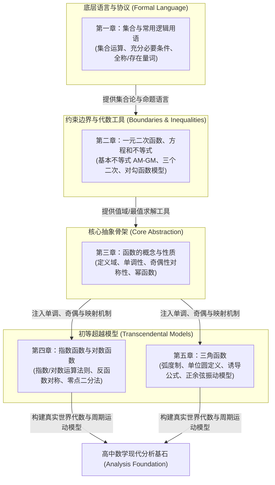
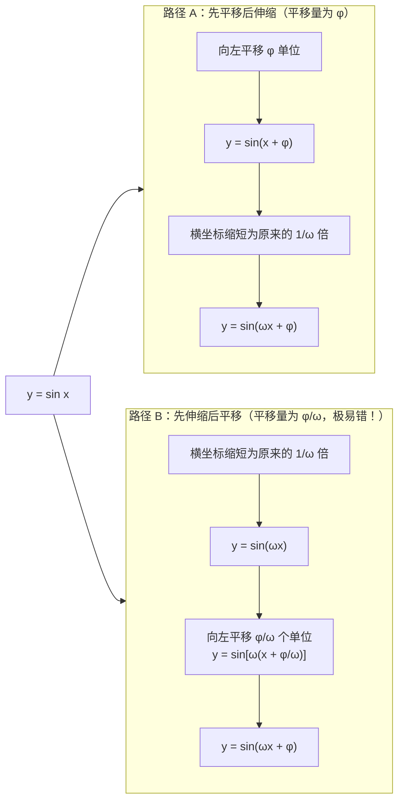

# 普通高中教科书·数学（A版）必修 第一册 —— 全景深度浓缩总结

> **核心哲学命题**：  
> 现代数学的基石与语言体系：以**集合与数理逻辑**为底层通信协议，以**不等式与方程**为边界控制约束，以**函数映射机制（Function Mapping）**为统一核心骨架，全面推进从代数多项式、初等超越函数（指数、对数）到周期振荡（三角函数）的完整数学建模闭环。

---

## 🗺️ 全书宏观认知架构（The Mathematical Paradigm）

高中数学必修一的核心脉络遵循“语言协议 $\to$ 边界工具 $\to$ 核心对象 $\to$ 具象模型”的严密递进关系：



---

## 第一章：集合与常用逻辑用语（现代数学的描述语言）

本章解决的核心问题是：**如何用无歧义的形式化数学符号精确表达数学研究的对象、边界与推理链条？**

### 1. 集合的概念与三大特质

* **集合（Set）的公理化特质**：
  * **确定性（Well-defined）**：任给元素 $x$ 与集合 $A$，必然满足 $x \in A$ 与 $x \notin A$ 二者之一且仅居其一（严禁含糊词汇如“较大的数”构成集合）。
  * **互异性（Distinctness）**：集合中的任意两个元素互不相同（即若 $a, b \in A$，必有 $a \ne b$）。*解题反模式防御：求出参数后，务必带回集合验证互异性！*
  * **无序性（Unordered）**：集合元素无先后次序，$\{a, b\} = \{b, a\}$。
* **常用数集标准代号**：
  * 自然数集（含 0）：$\mathbb{N}$；正整数集：$\mathbb{N}^*$ 或 $\mathbb{N}_+$；
  * 整数集：$\mathbb{Z}$；有理数集：$\mathbb{Q}$；实数集：$\mathbb{R}$。

### 2. 集合间的关系与“空集陷阱”

* **子集与真子集**：
  * 子集定义：$\forall x \in A \implies x \in B$，记为 $A \subseteq B$。
  * 集合相等：$A \subseteq B$ 且 $B \subseteq A \iff A = B$。
  * 真子集：$A \subseteq B$ 且 $\exists x \in B$ 但 $x \notin A$，记为 $A \subsetneqq B$。
  * 包含关系基数推论：含 $n$ 个元素的有限集，其子集个数为 $2^n$，真子集个数为 $2^n - 1$，非空真子集个数为 $2^n - 2$。
* **⚠️ 空集陷阱（Empty Set Trap）**：
  * 空集 $\emptyset$ 是**任何集合的子集**，是**任何非空集合的真子集**。
  * 在含参集合包含问题（如 $A \subseteq B$）中，若集合 $A$ 未明确非空，**必须无条件分 $A = \emptyset$ 和 $A \ne \emptyset$ 两大类讨论**！

### 3. 集合的基本运算与数轴/Venn图可视化

* **交集、并集与全集补集**：
  * 并集：$A \cup B = \{x \mid x \in A \text{ 或 } x \in B\}$
  * 交集：$A \cap B = \{x \mid x \in A \text{ 且 } x \in B\}$
  * 补集：$\complement_U A = \{x \mid x \in U \text{ 且 } x \notin A\}$
* **对偶律（德·摩根定律，De Morgan's Laws）**：
  $$\complement_U (A \cup B) = (\complement_U A) \cap (\complement_U B)$$
  $$\complement_U (A \cap B) = (\complement_U A) \cup (\complement_U B)$$
* **数轴法规范**：连续数集的交并补运算，必须绘制数轴。**端点实心（含等号）与空心（不含等号）是丢分高发区**。

### 4. 充分条件、必要条件与逻辑命题判定

* **命题推出关系与因果判定**：
  * 若 $p \implies q$，则 $p$ 是 $q$ 的**充分条件（Sufficient Condition）**，$q$ 是 $p$ 的**必要条件（Necessary Condition）**。
  * 若 $p \implies q$ 且 $q \implies p$（$p \iff q$），则 $p$ 与 $q$ 互为**充要条件（Equivalent / If and Only If）**。
* **集合观点看充要关系（范围包含论）**：
  * 设满足条件 $p$ 的元素集合为 $P = \{x \mid p(x)\}$，满足 $q$ 的元素集合为 $Q = \{x \mid q(x)\}$：
    * $P \subseteq Q \iff p$ 是 $q$ 的充分条件（**小范围推大范围，大范围推不出小范围**）；
    * $P \subsetneqq Q \iff p$ 是 $q$ 的充分不必要条件；
    * $Q \subsetneqq P \iff p$ 是 $q$ 的必要不充分条件；
    * $P = Q \iff p$ 是 $q$ 的充要条件。

### 5. 全称量词与存在量词及其命题否定

| 命题类型 | 形式化符号 | 命题语言表示 | 命题的否定（$\neg$） |
| :--- | :--- | :--- | :--- |
| **全称量词命题** | $\forall x \in M, p(x)$ | “对所有的 $x \in M$，$p(x)$ 成立” | $\exists x \in M, \neg p(x)$ |
| **存在量词命题** | $\exists x \in M, p(x)$ | “存在一个 $x \in M$，$p(x)$ 成立” | $\forall x \in M, \neg p(x)$ |

> **核心法则**：含有一个量词的命题否定三步法：**① 变更量词（$\forall \leftrightarrow \exists$）；② 条件集合 $M$ 纹丝不动；③ 否定结论谓词（$p(x) \to \neg p(x)$）**。

---

## 第二章：一元二次函数、方程和不等式（代数边界与最值优化）

本章解决的核心问题是：**如何利用严谨的代数结构推导变量取值界限，掌握高阶不等式与均值极值模型？**

### 1. 不等式的核心运算法则与变形准则

* **传递性与可加性**：$a > b, b > c \implies a > c$；$a > b \iff a + c > b + c$。
* **同向可加性**：$a > b, c > d \implies a + c > b + d$（*注意：同向不等式严禁相减！*）。
* **乘法保号性**：$a > b, c > 0 \implies ac > bc$；$a > b, c < 0 \implies ac < bc$（负数翻转不等号）。
* **倒数法则**：若 $a > b > 0$，则 $\frac{1}{a} < \frac{1}{b}$。

### 2. 基本不等式（AM-GM 不等式，算术-几何平均）

* **定理内容**：对于任意实数 $a > 0, b > 0$，均有：
  $$\frac{a + b}{2} \ge \sqrt{ab}$$
  当且仅当 $a = b$ 时，等号成立。
* **几何直观意义**：圆的直径为 $a+b$，半径为 $\frac{a+b}{2}$；半圆内弦的一半垂直于直径时长度为 $\sqrt{ab}$。弦长绝不超过直径，半径必然大于或等于半弦长。
* **最值黄金法则（积定和最小，和定积最大）**：
  * 若积 $ab = P$（常数），则 $a + b \ge 2\sqrt{P}$，即当 $a = b$ 时，$a + b$ 取得**最小值** $2\sqrt{P}$；
  * 若和 $a + b = S$（常数），则 $ab \le \frac{S^2}{4}$，即当 $a = b$ 时，$ab$ 取得**最大值** $\frac{S^2}{4}$。
* **使用铁律（“一正、二定、三相等”）**：
  1. **一正**：参与不等式的各项必须为正数（若为负数需提负号转化）；
  2. **二定**：和或积必须为常数（定值），若非定值需通过配凑裂项构造定值；
  3. **三相等**：等号成立的代数条件必须在变量定义域内部真实存在！

#### 经典构造技巧：
1. **配凑常数法**：求 $f(x) = x + \frac{1}{x-1} \ (x > 1)$ 的最小值：
   $$f(x) = (x - 1) + \frac{1}{x - 1} + 1 \ge 2\sqrt{(x-1)\cdot \frac{1}{x-1}} + 1 = 3$$
2. **常数代换（“1”的妙用）**：若实数 $a > 0, b > 0$ 且 $\frac{1}{a} + \frac{1}{b} = 1$，求 $a + b$ 最小值：
   $$a + b = (a + b)\left(\frac{1}{a} + \frac{1}{b}\right) = 1 + \frac{b}{a} + \frac{a}{b} + 1 = 2 + \left(\frac{b}{a} + \frac{a}{b}\right) \ge 2 + 2\sqrt{\frac{b}{a}\cdot\frac{a}{b}} = 4$$

### 3. 对勾函数模型（耐克函数 Nike Function）

* **标准解析式**：
  $$f(x) = x + \frac{a}{x} \quad (a > 0)$$
* **图象几何与单调性全景**：
  * **奇偶性**：$f(-x) = -f(x)$，为**奇函数**，图象关于原点对称。
  * **单调增区间**：$(-\infty, -\sqrt{a}]$ 以及 $[\sqrt{a}, +\infty)$；
  * **单调减区间**：$[-\sqrt{a}, 0)$ 以及 $(0, \sqrt{a}]$；
  * **极值点**：在第一象限，当 $x = \sqrt{a}$ 时取得极小值 $2\sqrt{a}$；在第三象限，当 $x = -\sqrt{a}$ 时取得极大值 $-2\sqrt{a}$。
* **对勾函数变体——飘带函数**：
  $$g(x) = x - \frac{a}{x} \quad (a > 0)$$
  奇函数，在定义域 $(-\infty, 0)$ 和 $(0, +\infty)$ 上均**严格单调递增**，无极值点。

### 4. “三个二次”的统一与含参不等式分类讨论

二次函数 $y = ax^2 + bx + c$、一元二次方程 $ax^2 + bx + c = 0$ 与一元二次不等式 $ax^2 + bx + c > 0$（$a > 0$）的判别式 $\Delta = b^2 - 4ac$ 对应关系：

```mermaid
classDiagram
    class 三个二次的判定体系 {
        +判别式 Delta = b^2 - 4ac
        +图象开口方向 a
        +对称轴 x = -b / (2a)
    }
    class Delta大于0 {
        方程根: x1 < x2 (两不等实根)
        大于0解集: (-∞, x1) U (x2, +∞) 两边跑
        小于0解集: (x1, x2) 中间夹
    }
    class Delta等于0 {
        方程根: x1 = x2 = -b / (2a)
        大于0解集: {x | x ≠ -b / (2a)}
        小于0解集: 空集 ∅
    }
    class Delta小于0 {
        方程根: 无实根
        大于0解集: 全体实数 R
        小于0解集: 空集 ∅
    }
    三个二次的判定体系 <|-- Delta大于0
    三个二次的判定体系 <|-- Delta等于0
    三个二次的判定体系 <|-- Delta小于0
```

* **含参不等式分类讨论工程流**：
  1. 讨论二次项系数 $a$：若含参，先讨论 $a = 0$（降次为一元一次不等式），再讨论 $a > 0$ 与 $a < 0$；
  2. 讨论判别式 $\Delta$：判断 $\Delta > 0, \Delta = 0, \Delta < 0$；
  3. 讨论根的大小：若 $\Delta > 0$，求得两根 $x_1, x_2$，必须根据参数取值比较 $x_1$ 与 $x_2$ 大小关系。

---

## 第三章：函数的概念与性质（高中数学的中心神经系统）

本章解决的核心问题是：**如何抽象描述两个集合之间的动态单值对应，并系统分析单调性、奇偶性与对称性等核心内禀属性？**

### 1. 函数概念与“定义域优先”总纲

* **近代函数定义**：设 $A, B$ 是非空实数集，如果对于集合 $A$ 中的任意一个数 $x$，按照某种确定的对应关系 $f$，在集合 $B$ 中都有**唯一确定**的数 $y$ 和它对应，那么就称 $f: A \to B$ 为从集合 $A$ 到集合 $B$ 的一个函数，记作 $y = f(x), x \in A$。
* **函数三要素**：**定义域（Domain）、对应法则 $f$、值域（Range）**。只要定义域与对应法则相同，两函数即为同一函数（与自变量符号无关）。
* **求函数定义域的五项基本法则（无条件优先原则）**：
  1. 分式结构：分母不得为 0（$g(x) \ne 0$）；
  2. 偶次方根结构：被开方数大于或等于 0（$g(x) \ge 0$）；
  3. 零指数幂结构：底数不得为 0（$[g(x)]^0 \implies g(x) \ne 0$）；
  4. 对数结构：对数真数严格大于 0，底数大于 0 且不等于 1；
  5. 正切结构：$\tan(g(x)) \implies g(x) \ne \frac{\pi}{2} + k\pi \ (k \in \mathbb{Z})$。

* **抽象函数定义域求解逻辑**：
  * **法则 A（内层求外层）**：已知 $f(x)$ 的定义域为 $[a, b]$，求 $f(g(x))$ 的定义域，解不等式 $a \le g(x) \le b$ 即可解出 $x$。
  * **法则 B（外层求内层）**：已知 $f(g(x))$ 的定义域为 $[a, b]$，是指自变量 $x \in [a, b]$，求 $g(x)$ 在此区间的值域 $[c, d]$，则 $f(t)$ 的定义域即为 $[c, d]$。

### 2. 函数单调性与最值判定（严格定义法）

* **单调递增与递减的数学定义**：
  * 设区间 $I \subseteq D$。若对于任意 $x_1, x_2 \in I$，当 $x_1 < x_2$ 时，都有 $f(x_1) < f(x_2)$，则称 $f(x)$ 在区间 $I$ 上为**严格增函数**；
  * 若当 $x_1 < x_2$ 时，都有 $f(x_1) > f(x_2)$，则称 $f(x)$ 在区间 $I$ 上为**严格减函数**。
* **定义法证明单调性五步工业流水线**：
  $$\text{① 任取 } x_1, x_2 \in I \text{ 且 } x_1 < x_2 \longrightarrow \text{② 作差 } f(x_1) - f(x_2) \longrightarrow \text{③ 变形（因式分解/通分配方）} \longrightarrow \text{④ 判断差值正负号} \longrightarrow \text{⑤ 结论}$$
* **复合函数单调性法则（“同增异减”律）**：
  * 设复合函数 $y = f(g(x))$，内层 $u = g(x)$，外层 $y = f(u)$：
    * 若 $u = g(x)$ 与 $y = f(u)$ 在相应定义域区间上**同增或同减**，则复合函数 $y = f(g(x))$ 为**增函数**；
    * 若 $u = g(x)$ 与 $y = f(u)$ 在相应定义域区间上**一增一减**，则复合函数 $y = f(g(x))$ 为**减函数**。
  * *关键警示：必须在复合函数的公共有效定义域内讨论，切勿超范围！*

### 3. 函数奇偶性、对称中心与对称轴全矩阵

* **奇函数与偶函数的本质**：
  * **前提**：定义域区间必须**关于原点对称**（若定义域不对称，直接下结论为非奇非偶函数！）；
  * **偶函数（Even）**：$\forall x \in D, f(-x) = f(x) \iff$ 图象关于 **$y$ 轴对称**；
  * **奇函数（Odd）**：$\forall x \in D, f(-x) = -f(x) \iff$ 图象关于 **原点 $(0,0)$ 对称**。
    * *奇函数重要推论*：若奇函数 $f(x)$ 在 $x = 0$ 处有定义，则必有 $f(0) = 0$。

#### 函数对称性与周期性代数映射关系：

| 几何对称性质 | 代数恒等式表示 | 联动周期结论（若同时成立） |
| :--- | :--- | :--- |
| **图象关于直线 $x = a$ 轴对称** | $f(a+x) = f(a-x)$ 或 $f(x) = f(2a-x)$ | 若同时关于 $x=a$ 与 $x=b$ 对称 $\implies$ **周期 $T = 2\|a-b\|$** |
| **图象关于点 $(a, b)$ 中心对称** | $f(a+x) + f(a-x) = 2b$ | 若同时关于 $(a,0)$ 与 $(b,0)$ 对称 $\implies$ **周期 $T = 2\|a-b\|$** |
| **图象关于点 $(a, 0)$ 中心对称** | $f(a+x) = -f(a-x)$ 或 $f(x) = -f(2a-x)$ | 若一条对称轴 $x=a$ 且一个对称中心 $(b,0)$ $\implies$ **周期 $T = 4\|a-b\|$** |

### 4. 幂函数模型（$y = x^\alpha$）

* 常见五大基本幂函数：$y = x, y = x^2, y = x^3, y = x^{\frac{1}{2}} = \sqrt{x}, y = x^{-1} = \frac{1}{x}$。
* **共性特征**：
  * 在第一象限 $(0, +\infty)$ 内部，所有幂函数图象必恒过定点 **$(1, 1)$**；
  * 当 $\alpha > 0$ 时，图象过原点 $(0,0)$，且在 $(0, +\infty)$ 上严格递增；
  * 当 $\alpha < 0$ 时，图象不过原点，且在 $(0, +\infty)$ 上严格递减，以坐标轴为渐近线。

---

## 第四章：指数函数与对数函数（初等超越分析与反演结构）

本章解决的核心问题是：**如何突破多项式增长模型，掌握爆炸式增长（指数）、缓慢平缓增长（对数）及其相互映射关系？**

### 1. 根式、分数指数幂与实数指数幂

* **分数指数幂与根式的代数等价**：
  $$a^{\frac{m}{n}} = \sqrt[n]{a^m} \quad (a > 0, m, n \in \mathbb{N}^*, n > 1)$$
  $$a^{-\frac{m}{n}} = \frac{1}{a^{\frac{m}{n}}} = \frac{1}{\sqrt[n]{a^m}} \quad (a > 0, m, n \in \mathbb{N}^*, n > 1)$$
* **指数幂运算法则**：$a^r a^s = a^{r+s}$；$(a^r)^s = a^{rs}$；$(ab)^r = a^r b^r$。

### 2. 指数函数（$y = a^x$）

* **定义**：$y = a^x \ (a > 0, a \ne 1)$，定义域为 $\mathbb{R}$，值域为 $(0, +\infty)$。
* **图象几何特性**：
  * 必恒过定点 **$(0, 1)$**；
  * 当 $a > 1$ 时，为 $\mathbb{R}$ 上的严格增函数（底大图陡）；
  * 当 $0 < a < 1$ 时，为 $\mathbb{R}$ 上的严格减函数。

### 3. 对数概念与换底定理网络

* **对数定义**：若 $a^x = N \ (a > 0, a \ne 1)$，则 $x = \log_a N$（$a$ 为底数，$N$ 为真数且 $N > 0$）。
* **恒等式与基本运算法则**：
  * 对数恒等式：$a^{\log_a N} = N$；$\log_a a^N = N$；$\log_a 1 = 0$；$\log_a a = 1$。
  * 积/商/幂转化：
    $$\log_a(MN) = \log_a M + \log_a N \quad (M, N > 0)$$
    $$\log_a\left(\frac{M}{N}\right) = \log_a M - \log_a N$$
    $$\log_a M^n = n \log_a M \quad (M > 0, n \in \mathbb{R})$$
    $$\log_{a^m} b^n = \frac{n}{m} \log_a b$$
* **换底公式（Base-Change Theorem）及其核心推论**：
  $$\log_b a = \frac{\log_c a}{\log_c b} \quad (c > 0, c \ne 1)$$
  * 倒数推论：$\log_a b = \frac{1}{\log_b a} \iff \log_a b \cdot \log_b a = 1$；
  * 链式推论：$\log_a b \cdot \log_b c \cdot \log_c d = \log_a d$。

### 4. 对数函数与反函数（$y = \log_a x$）

* **定义**：$y = \log_a x \ (a > 0, a \ne 1)$，定义域 $(0, +\infty)$，值域 $\mathbb{R}$。
* **图象几何特性**：必恒过定点 **$(1, 0)$**。当 $a > 1$ 时单调递增；当 $0 < a < 1$ 时单调递减。
* **反函数镜像对称**：
  * 指数函数 $y = a^x$ 与对数函数 $y = \log_a x$ 互为**反函数（Inverse Function）**。
  * 它们的图象关于直线 **$y = x$ 轴对称**。点 $(x_0, y_0)$ 在 $y=a^x$ 上 $\iff$ 点 $(y_0, x_0)$ 在 $y=\log_a x$ 上。

### 5. 函数的零点与二分法算法原理

* **函数零点本质**：函数 $y = f(x)$ 的零点不是点，而是使 $f(x) = 0$ 的**实数根 $x_0$**，即图象与 $x$ 轴交点的横坐标。
* **零点存在定理（Bolzano定理）**：
  * 若函数 $y = f(x)$ 在闭区间 $[a, b]$ 上的图象是连续不间断的，且满足 **$f(a) \cdot f(b) < 0$**（端点异号）；
  * 则在开区间 $(a, b)$ 内至少存在一个零点 $c$，使得 $f(c) = 0$。
  * *单调性叠加*：若 $f(x)$ 在 $[a, b]$ 上同时为严格单调函数，则其在 $(a, b)$ 内**有且仅有一个零点**。
* **二分法（Bisection Method）算法流程**：
  计算区间中点 $m = \frac{a+b}{2}$ 的函数值 $f(m)$，若 $f(m)=0$ 则终止；若 $f(a)f(m)<0$ 则将区间缩小为 $[a, m]$；反之缩小为 $[m, b]$；迭代直到区间长度 $|b-a| < \epsilon$（给定精确度）。

---

## 第五章：三角函数（周期振荡与圆周几何映射）

本章解决的核心问题是：**如何从有限直角三角形的锐角三角学，跃迁到在实数域连续循环振荡的任意角三角体系？**

### 1. 任意角与弧度制（角与实数的完全同构）

* **角的概念拓展**：按逆时针方向旋转形成的角为**正角**；顺时针为**负角**；不做旋转为**零角**。
* **终边相同角集合**：与角 $\alpha$ 终边相同的角的全体表示为：
  $$S = \{\beta \mid \beta = \alpha + 2k\pi, k \in \mathbb{Z}\} = \{\beta \mid \beta = \alpha + k \cdot 360^\circ, k \in \mathbb{Z}\}$$
* **弧度制（Radian Measure）定义**：长度等于半径长 $r$ 的圆弧所对的圆心角叫做 $1$ 弧度的角。
  $$\alpha = \frac{l}{r} \implies 180^\circ = \pi\text{ rad}, \quad 1^\circ = \frac{\pi}{180}\text{ rad}, \quad 1\text{ rad} = \left(\frac{180}{\pi}\right)^\circ \approx 57.30^\circ$$
* **核心几何计算公式**：
  * 弧长公式：$l = |\alpha| r$
  * 扇形面积公式：$S = \frac{1}{2}lr = \frac{1}{2}|\alpha|r^2$

### 2. 任意角三角函数的单位圆坐标定义与符号律

设 $\alpha$ 是一个任意角，它的终边与单位圆（$x^2 + y^2 = 1$）交于点 $P(x, y)$：
$$\sin\alpha = y, \quad \cos\alpha = x, \quad \tan\alpha = \frac{y}{x} \ (x \ne 0)$$

* **三角函数象限符号口诀（“一全正，二正弦，三正切，四余弦”）**：
  * 第一象限：全为正；
  * 第二象限：$\sin\alpha > 0$，余为负；
  * 第三象限：$\tan\alpha > 0$，余为负；
  * 第四象限：$\cos\alpha > 0$，余为负。
* **同角三角函数核心恒等式**：
  * 平方关系：$\sin^2\alpha + \cos^2\alpha = 1$
  * 商数关系：$\tan\alpha = \frac{\sin\alpha}{\cos\alpha}$
* **工程技巧（齐次式弦化切）**：
  对于齐次分式，分子分母同除以 $\cos\alpha$ 或 $\cos^2\alpha$：
  $$\frac{a\sin\alpha + b\cos\alpha}{c\sin\alpha + d\cos\alpha} = \frac{a\tan\alpha + b}{c\tan\alpha + d}$$
  $$\sin^2\alpha - 3\sin\alpha\cos\alpha + 2\cos^2\alpha = \frac{\sin^2\alpha - 3\sin\alpha\cos\alpha + 2\cos^2\alpha}{\sin^2\alpha + \cos^2\alpha} = \frac{\tan^2\alpha - 3\tan\alpha + 2}{\tan^2\alpha + 1}$$

### 3. 诱导公式大一统规则（“奇变偶不变，符号看象限”）

诱导公式用于将任意角 $\alpha + k\frac{\pi}{2}$ 化归为锐角三角函数。

* **终极判定两部曲**：
  1. **“奇变偶不变”**：观察表达式中的 $\frac{k\pi}{2} \pm \alpha$。若 $k$ 是**奇数**，正余弦互变（$\sin \leftrightarrow \cos$）；若 $k$ 是**偶数**，函数名保持不变。
  2. **“符号看象限”**：**假定 $\alpha$ 为第一象限锐角**，判断角 $\frac{k\pi}{2} \pm \alpha$ 所在的象限，原函数在该象限的原本正负符号，即为化简后结果的符号！

```
示例：化简 sin(3π/2 - α)
1. 3π/2 = 3 * (π/2)，k = 3 是奇数，sin 必须变为 cos；
2. 假定 α 是锐角，3π/2 - α 落在第三象限；
3. 原函数 sin 在第三象限为负（-）；
故：sin(3π/2 - α) = -cos α
```

### 4. 正余弦与正切函数图象性质全景表

| 函数 | 定义域 | 值域 | 最小正周期 | 奇偶性 | 对称中心 | 对称轴 |
| :--- | :--- | :--- | :--- | :--- | :--- | :--- |
| **$y = \sin x$** | $\mathbb{R}$ | $[-1, 1]$ | $2\pi$ | 奇函数 | $(k\pi, 0)$ | $x = \frac{\pi}{2} + k\pi$ |
| **$y = \cos x$** | $\mathbb{R}$ | $[-1, 1]$ | $2\pi$ | 偶函数 | $(\frac{\pi}{2} + k\pi, 0)$ | $x = k\pi$ |
| **$y = \tan x$** | $\{x \mid x \ne \frac{\pi}{2} + k\pi\}$ | $\mathbb{R}$ | $\pi$ | 奇函数 | $(\frac{k\pi}{2}, 0)$ | **无对称轴** |

### 5. 正弦型函数 $y = A\sin(\omega x + \varphi) + B$ 的物理参量与图象变换

* **物理与几何参量解析**：
  * $A$：**振幅（Amplitude）**，偏离平衡位置的最大位移，值域为 $[-A+B, A+B]$（设 $A > 0$）；
  * $\omega$：**角频率（Angular Frequency）**，$\omega > 0$，周期 $T = \frac{2\pi}{\omega}$；
  * $\omega x + \varphi$：**相位（Phase）**；
  * $\varphi$：**初相（Initial Phase）**（$x=0$ 时的相位）。
* **图象平移变换的两条正统路径与避坑焦点**：



> **核心原则**：图象左右平移**永远只针对自变量 $x$ 自身生效**！若已经存在系数 $\omega$（即 $\sin(\omega x)$），平移量必须提出 $\omega$，即 $\sin[\omega(x + \frac{\varphi}{\omega})]$，平移距离为 $\frac{|\varphi|}{\omega}$！

---

## ⚠️ 高中数学必修一：典型反模式与认知误区清单 (Anti-Patterns)

| 典型认知误区 (Anti-Pattern) | 数学逻辑破坏与失分点分析 | 科学认知与避坑工程法则 |
| :--- | :--- | :--- |
| **反模式 1：子集讨论遗漏空集 $\emptyset$** | 在 $A \subseteq B$ 条件下，默认集合 $A$ 必然有元素，直接套用方程根判别式 $\Delta \ge 0$，漏解 $A = \emptyset$（即 $\Delta < 0$）的大面积参数解集。 | 只要遇到 $A \subseteq B$ 或 $A \cap B = \emptyset$，脑海中第一道门禁必须是：“**若 $A$ 是空集是否合法？**”。强制分 $A=\emptyset$ 和 $A\ne\emptyset$ 双分支处理。 |
| **反模式 2：基本不等式盲目套用** | 忽略“一正二定三相等”，如在 $x < 0$ 时直接套用 $x + \frac{1}{x} \ge 2$，或在两处不同不等式连环取等时，等号成立条件相互冲突。 | 严密审查三步：① 各变量是否全部大于 0；② 乘积或和是否消去变量成为常数；③ 求解等号方程组，确保解在变量定义域内部真实存在。 |
| **反模式 3：复合函数单调性脱离定义域** | 在求 $y = \log_{0.5}(x^2 - 4x + 3)$ 的单调区间时，直接把二次函数的单调区间当作复合函数的区间，导致真数小于等于 0 的非法区间混入答案。 | **定义域优先原则是函数唯一宪法！** 求单调性前必须先列不等式 $x^2 - 4x + 3 > 0$ 解出定义域，所有后续单调区间必须与定义域求交集。 |
| **反模式 4：奇偶性判断未先校验定义域对称性** | 看到形如 $f(x) = \frac{x^2 - 1}{x - 1}$ 立即化简为 $x + 1$，然后妄下结论；或者没检查区间，算 $f(-x)$ 误判奇偶性。 | 判定奇偶性**第零步**：检查定义域是否关于原点对称！若 $x \in [-1, 2)$，直接断定“非奇非偶函数”，一步都不用算。 |
| **反模式 5：三角函数图象平移“先缩后移”混淆偏移量** | 由 $y = \sin(2x)$ 得到 $y = \sin(2x + \frac{\pi}{3})$，错误地认为应“向左平移 $\frac{\pi}{3}$ 个单位”，导致相位整体偏离。 | 谨记“平移只对自变量 $x$ 发生”。改写为 $y = \sin[2(x + \frac{\pi}{6})]$，实际平移距离为 $\frac{\pi}{6}$（即 $\frac{\varphi}{\omega}$）。 |
| **反模式 6：对数运算忽视真数限制引入增根** | 解对数方程或不等式时，随意使用 $\log_a x^2 = 2\log_a x$，导致定义域从 $x \ne 0$ 被非法收缩为 $x > 0$，引发丢解或增根。 | 对数拆分必须遵守双向等价性：$\log_a x^2 = 2\log_a |x|$；合并 $\log_a A + \log_a B = \log_a(AB)$ 时必须先前提 $A > 0$ 且 $B > 0$。 |

---

## 🎯 数学解题工程流与经典模型 SOP (Actionable Problem-Solving SOP)

### 模块 1：参数取值范围与恒成立问题处理 SOP

面对题目中出现“对任意 $x \in [a, b]$，不等式 $f(x, \lambda) \ge 0$ 恒成立”：

```
[步骤 1: 变量与参数解耦审查] ──> 能否实现参变分离？
       │
       ├──> [分支 A: 可分离参数] ──> 将不等式转化为 λ ≥ g(x) 或 λ ≤ g(x)
       │                             • 若 λ ≥ g(x) 恒成立 ⟹ λ ≥ [g(x)]_max
       │                             • 若 λ ≤ g(x) 恒成立 ⟹ λ ≤ [g(x)]_min
       │                             • 转化为求函数 g(x) 在区间上的闭环最值
       │
       └──> [分支 B: 不可分离参数] ──> 构造主元函数 F(x) = f(x, λ)
                                     • 结合二次函数对称轴、单调性与端点值
                                     • 建立不等式组（如端点判别法、最值分析）闭环求解
```

### 模块 2：抽象函数与综合性质联动解题 SOP

遇到给出抽象函数关系式（如 $f(x+y) = f(x) + f(y)$ 或对称式）并要求解不等式 $f(2x-1) < f(3)$：

```
[步骤 1: 探求特殊赋值] ──> 令 x = y = 0 或 x = y = 1，求出 f(0) 或 f(1) 的基准值
       │
[步骤 2: 奇偶性代数化简] ──> 赋特殊值（如令 y = -x），证明 f(-x) = -f(x) 或 f(-x) = f(x)
       │
[步骤 3: 单调性严密确立] ──> 任取 x1 < x2，设 x2 = x1 + Δx (Δx > 0)，
                             作差 f(x2) - f(x1) = f(Δx)，根据题设条件定符号
       │
[步骤 4: 脱去函数外壳 'f'] ──> 依据 f(u) 的单调性，将函数不等式转化为关于自变量的纯代数不等式组：
                             注意：必须同时联立两端各自的【定义域约束】！
```

### 模块 3：正弦型函数 $y = A\sin(\omega x + \varphi) + B$ 的逆向建模 SOP

已知图象波形特征点，求解析式三步法：

```
[步骤 1: 定振幅 A 与偏置 B] ──> 提取波峰 y_max 与波谷 y_min:
                                A = (y_max - y_min) / 2
                                B = (y_max + y_min) / 2
       │
[步骤 2: 定角频率 ω] ────────> 提取相邻波峰与波谷横坐标距离 Δx = T / 2:
                                周期 T = 2 * Δx ⟹ ω = 2π / T
       │
[步骤 3: 定初相 φ] ──────────> 代入“五点法”中的第一特殊点（升零点、最高点）:
                                若点 (x0, y_max) 为最高点，则令 ω · x0 + φ = π/2 + 2kπ
                                结合题设范围（如 |φ| < π 或 |φ| < π/2）锁定唯一的 φ
```

---

## 💡 一句话数学观总结

> **数学不是盲目刷题的算术苦力，而是以集合与命题为基石协议，以不等式为边界护栏，以函数映射为动力引擎，将世间万物的非线性爆炸与周而复始的周期波动，提炼为纯粹优雅代数结构的宏伟认知大厦！**
