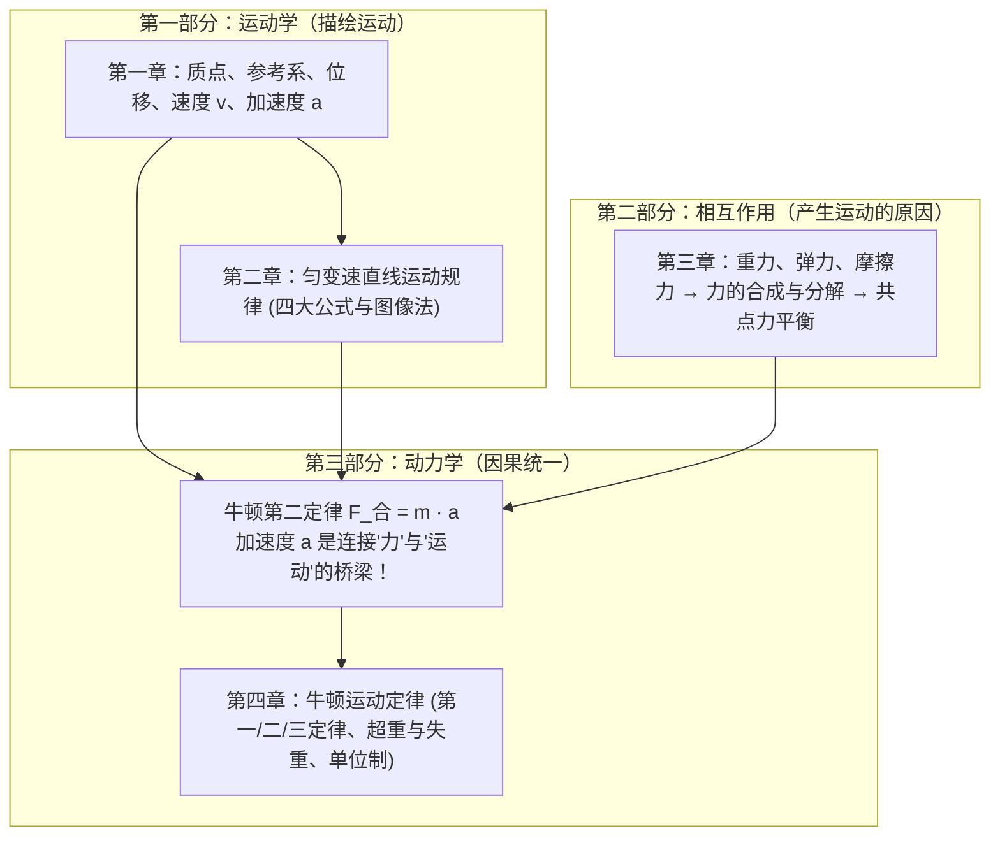
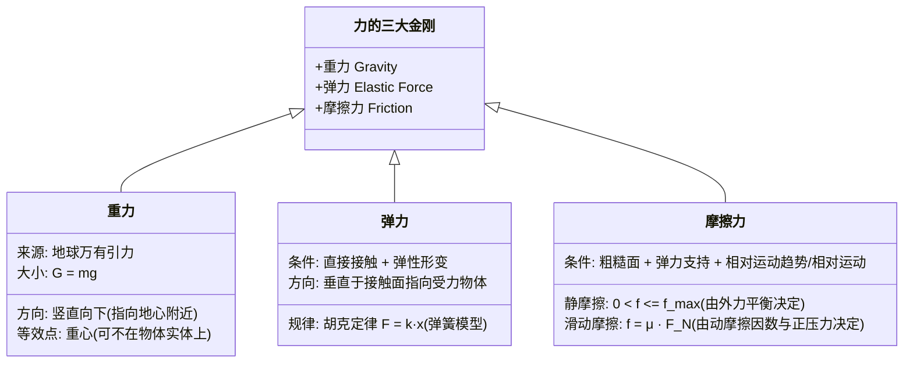

# 普通高中教科书·物理 必修 第一册 —— 全景深度浓缩总结

> **核心哲学命题**：  
> 经典力学奠基篇：构建从“运动学的时空几何描述（Kinematics，怎么动）”到“动力学的因果因律探寻（Dynamics，为何动）”的完整逻辑闭环，确立以**牛顿运动定律**为核心的经典宏观物理世界观。

---

## 🗺️ 全书宏观认知架构（The Mechanical Paradigm）

高中物理必修一的核心脉络可以用以下因果链完全囊括：



---

## 第一章：运动的描述（时空与运动物理学语言）

本章解决的核心问题是：**如何用精确的物理概念与数学工具描述物体的机械运动？**

### 1. 核心概念与理想物理模型
* **质点（Point Mass）**：
  * **定义**：用来代替物体的具有质量的点。
  * **理想化条件**：物体的**形状与大小**对所研究的问题影响可忽略不计（*关键法则：小物体不一定能看成质点，庞大物体在特定问题中可看成质点，如公转的地球*）。
* **参考系（Frame of Reference）**：
  * 描述运动必须选定参考系（运动的相对性）；通常选地面或相对地面静止的物体为参考系。
* **位置与位移（Position & Displacement）**：
  * **标量与矢量**：路程是标量（轨迹长度，无方向）；位移是矢量（初位置指向末位置的有向线段 $\Delta x = x_2 - x_1$）。只有在单向直线运动中，位移的大小才等于路程。
* **速度（Velocity）**：
  * **平均速度**：$\bar{v} = \frac{\Delta x}{\Delta t}$（粗略描述过程快慢，方向沿位移方向）。
  * **瞬时速度**：$v = \lim_{\Delta t \to 0} \frac{\Delta x}{\Delta t}$（精确描述某一时刻/位置的运动快慢，极微元思想）。
  * *速度与速率*：速率是瞬时速度的大小（标量）；平均速率等于路程除以时间（不等于平均速度的大小）。
* **加速度（Acceleration）**：
  * **定义与物理意义**：$a = \frac{\Delta v}{\Delta t} = \frac{v_t - v_0}{\Delta t}$，描述**速度变化快慢**的物理量（变化率），单位 $\text{m/s}^2$。
  * **本质判断**：
    * $a$ 与 $v$ 同向 $\implies$ 物体加速；
    * $a$ 与 $v$ 反向 $\implies$ 物体减速；
    * $a$ 增大/减小仅代表速度改变的“剧烈程度”，与物体正在“加速还是减速”无直接正负绑定关系！

### 2. 核心实验：测量直线运动物体的瞬时速度
* **打点计时器**（电磁打点计时器 4~6V 交流电；电火花打点计时器 220V 交流电，打点周期 $T = 0.02\text{ s}$）。
* **平均速度逼近法**：计算某点 $n$ 的瞬时速度，取该点前后对称两点之间的平均速度：
  $$v_n = \frac{x_{n-1, n+1}}{2T}$$

---

## 第二章：匀变速直线运动（规则运动的数学建模）

本章解决的核心问题是：**加速度恒定状态下，位置、速度与时间的精确数学解析。**

### 1. 核心运动学公式矩阵（四大金刚方程）

| 序号 | 公式名称 | 公式表达式 | 缺失变量（优先使用条件） |
| :--- | :--- | :--- | :--- |
| **1** | 速度-时间关系 | $v = v_0 + at$ | 无位移 $x$ |
| **2** | 位移-时间关系 | $x = v_0 t + \frac{1}{2}at^2$ | 无末速度 $v$ |
| **3** | 速度-位移关系 | $v^2 - v_0^2 = 2ax$ | **无时间 $t$（解题利器）** |
| **4** | 平均速度位移式 | $x = \frac{v_0 + v}{2} t = \bar{v} t$ | 无加速度 $a$ |

### 2. 匀变速直线运动关键推论与比例法则
1. **任意连续相等时间间隔 $T$ 内的位移差恒定（逐差法则）**：
   $$\Delta x = x_2 - x_1 = x_3 - x_2 = \dots = aT^2 \implies x_m - x_n = (m-n)aT^2$$
   *实验中求解加速度的标准算法：**逐差法**，可消除偶发测量误差。*
2. **中间时刻瞬时速度与中间位置瞬时速度**：
   * 中间时刻瞬时速度：$v_{t/2} = \bar{v} = \frac{v_0 + v}{2}$
   * 中间位置瞬时速度：$v_{x/2} = \sqrt{\frac{v_0^2 + v^2}{2}}$
   * 普遍规律：无论加速还是减速运动，**恒有 $v_{x/2} > v_{t/2}$**（匀速时相等）。
3. **初速度为零（$v_0=0$）的比例法则**：
   * $1T末、2T末、3T末\dots$ 速度之比：$1 : 2 : 3 : \dots : n$
   * 前 $1T、前 2T、前 3T\dots$ 内位移之比：$1 : 4 : 9 : \dots : n^2$
   * 连续相等时间内位移之比：$1 : 3 : 5 : \dots : (2n-1)$

### 3. 典型物理模型
* **自由落体运动（Free Fall）**：
  * 特点：$v_0 = 0$，$a = g$（重力加速度，一般取 $9.8\text{ m/s}^2$ 或 $10\text{ m/s}^2$，随纬度增高而增大，随海拔升高而减小）。
  * 公式化简：$v = gt$，$h = \frac{1}{2}gt^2$，$v^2 = 2gh$。
* **汽车刹车与追及相遇模型**：
  * **刹车陷阱**：必须先算**刹车停止时间** $t_0 = \frac{v_0}{a}$！若所给时间 $t > t_0$，位移不能带入 $t$，而应以 $t_0$ 计算实际刹车距离。
  * **追及临界点**：两车间距最大或最小的临界条件，必然发生在**两车速度相等（$v_A = v_B$）的瞬间**。

---

## 第三章：相互作用（力的本质与静态平衡）

本章解决的核心问题是：**力是什么？常见力的产生机制是什么？共点力如何合成、分解与实现平衡？**

### 1. 三大自然界宏观力机制



* **重心判定**：物体的几何中心与质量分布共同决定；悬挂法（二力平衡）适用于薄板类物体。
* **轻绳与轻弹簧模型**：
  * **轻绳**：张力突变极快，不可伸长，拉力只能沿绳收缩方向。
  * **轻弹簧**：形变量发生需要时间，在瞬时变化问题中，**弹簧弹力不能突变**。

### 2. 力的合成与分解法则
* **平行四边形定则与三角形定则**：矢量运算法则的本质。
  * 合力范围：$|F_1 - F_2| \le F_{合} \le F_1 + F_2$。
* **正交分解法（Orthogonal Decomposition）**：
  * 建立平面直角坐标系（通常选沿运动/加速度方向为 $x$ 轴，垂直方向为 $y$ 轴）：
    $$\begin{cases} F_x = \sum F_{xi} \\ F_y = \sum F_{yi} \end{cases}$$

### 3. 共点力平衡条件与处理技巧
* **平衡状态**：静止或匀速直线运动（$a = 0$）。
* **平衡条件**：合外力为零，即 $\sum F = 0$。
* **动态平衡三大解法**：
  1. **图解法（矢量三角形法）**：适用于一个力恒定、一个力方向不变、第三个力大小方向均变。
  2. **相似三角形法**：适用于力构成的三角形与物体的空间几何三角形相似。
  3. **正交分解解析法**：列方程用三角函数讨论极值。

---

## 第四章：牛顿运动定律（宏观低速经典力学基石）

本章解决的核心问题是：**力与运动之间的因果律统一（动力学大一统）。**

### 1. 牛顿三定律精义解析

| 定律 | 物理核心内涵 | 哲学/思维突破 |
| :--- | :--- | :--- |
| **牛顿第一定律**<br>(惯性定律) | 一切物体在不受力或受合力为零时，总保持静止或匀速直线运动。**惯性是物质固有属性，唯一量度是质量 $m$。** | 彻底推翻“力是维持运动的原因”（亚里士多德），明确“力是改变物体运动状态（产生加速度）的原因”。 |
| **牛顿第二定律**<br>(动力学方程) | 物体的加速度与所受合外力成正比，与质量成反比：<br>$$\mathbf{F}_{合} = m\mathbf{a}$$ | 确立因果关系：力是因，加速度是果。具备**同体性、瞬时性、矢量性、独立性**。 |
| **牛顿第三定律**<br>(相互作用定律) | 两个物体之间的作用力与反作用力总是**大小相等、方向相反、作用在同一条直线上**：<br>$$F = -F'$$ | 揭示力的相互性。作用力与反作用力**同生同灭同性质、分别作用在两个物体上**（绝不能抵消）。 |

### 2. 核心实验：探究加速度与力、质量的关系
* **实验方法**：**控制变量法**（固定 $m$ 探究 $a$ 与 $F$；固定 $F$ 探究 $a$ 与 $m$）。
* **关键操作与减小误差**：
  1. **平衡摩擦力**：将木板一端垫高，使小车重力沿斜面的分力恰好等于小车所受摩擦力（纸带打出点迹均匀分布即平衡完成）。
  2. **悬挂物条件**：只有满足**悬挂重物质量 $m_0 \ll$ 小车质量 $M$** 时，绳的拉力才近似等于悬挂物的重力 $m_0g$。

### 3. 超重与失重（Apparent Weight vs Real Weight）
* **本质判断**：不是看物体往上走还是往下走，**纯粹由加速度 $a$ 的方向决定！**
  * **超重**：$a$ 方向**竖直向上**（向上加速 或 向下减速），支持力/拉力 $F_N = m(g+a) > mg$。
  * **失重**：$a$ 方向**竖直向下**（向下加速 或 向上减速），支持力/拉力 $F_N = m(g-a) < mg$。
  * **完全失重**：$a = g$ 竖直向下，此时视重为零（如自由落体、人造卫星内部物体，天平失效、浮力消失）。

### 4. 力学单位制（SI Units）
* **基本量与基本单位**：长度（米，$\text{m}$）、质量（千克，$\text{kg}$）、时间（秒，$\text{s}$）。
* **导出单位**：由基本单位根据物理公式推导出来的单位（如 $\text{N} = \text{kg}\cdot\text{m/s}^2$）。
* **物理妙用**：**量纲检验法**（检查推导公式两边单位是否一致，不一致必错）。

---

## ⚠️ 高中物理必修一：典型反模式与认知误区清单 (Anti-Patterns)

| 典型认知误区 (Anti-Pattern) | 物理危害与错误结果 | 科学认知与避坑法则 |
| :--- | :--- | :--- |
| **误区 1**：物体的速度越大，其加速度一定越大 | 混淆“状态量”与“变化率”，导致运动学定性判断彻底失分 | 速度大加速度可以为零（如高速飞行的客机）；加速度大速度可以为零（如火箭点火瞬间）。 |
| **误区 2**：平衡力就是作用力与反作用力 | 乱抵消内力，无法正确建立受力隔离方程 | 相互作用力作用在**两个不同物体**上，不可合成抵消；一对平衡力作用在**同一个物体**上。 |
| **误区 3**：摩擦力的方向一定与物体的运动方向相反 | 无法分析传送带、车辆驱动轮受力 | 摩擦力阻碍的是**相对运动（或趋势）**，不是阻碍物体本身的运动；摩擦力完全可以是动力！ |
| **误区 4**：汽车刹车直接套用 $x = v_0 t + \frac{1}{2}at^2$ | 计算出车辆停下后“倒退”的荒谬位移 | 必先算刹车停下耗时 $t_0 = \frac{v_0}{\|a\|}$，比较题目时间 $t$ 与 $t_0$ 大小。 |
| **误区 5**：超重状态下物体的重力变大了 | 把“视重”等同于“地心引力” | 物体真实受到的重力 $G=mg$ 从未改变，改变的只是接触面上的弹力/支持力（视重）。 |

---

## 🎯 动力学解题工程流（Actionable Problem-Solving SOP）

遇到必修一复杂力学综合题（如传送带模型、滑块-木板模型），严格遵循以下五步工法：

```
[步骤 1: 确定研究对象] ──> 确定整体法还是隔离法
       │
[步骤 2: 规范受力分析] ──> 按 一重、二弹、三摩擦、四其他 严密画受力图
       │
[步骤 3: 运动状态审视] ──> 分析轨迹、初始速度、运动过程与临界点
       │
[步骤 4: 建立正交坐标] ──> 沿加速度方向设 x 轴，垂直方向设 y 轴列方程：
                          Σ Fx = m · ax  /  Σ Fy = 0
       │
[步骤 5: 运动学连立解] ──> 提取加速度 a，连接运动学四大公式求解未知量
```

---

## 💡 一句话物理观总结

> **物理不是死记硬背公式，而是通过“质点”剥离纷繁杂象，用“微元与极限”捕捉运动瞬态，借助“牛顿二定律”这根金线，将空间与时间的几何形态，与世间万物的受力因果严密缝合！**
